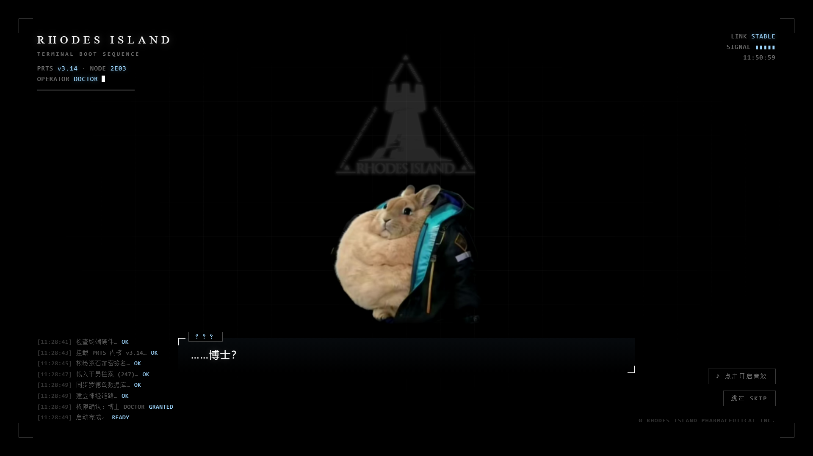

# 罗德岛兔兔 · RHODES RABBIT

明日方舟风格的 **DeepSeek Harness** 插件两件套：一只是开机时在终端里冒出来的兔子，
播完之后它不会走，会留在你的界面上当桌宠。



| 桌宠 · 待机 | 设置面板 | 喂胡萝卜 |
| --- | --- | --- |
|  |  |  |

---

## 两个插件

| 插件 | 是什么 | 版本 |
| --- | --- | --- |
| **`dsh-rhodes-boot`** | **开启动画**：打开 Harness 时的终端启动序列，进度按真实网络状况走，兔子会在加载时登场、还能戳它喂胡萝卜 | 1.18.0 |
| **`dsh-rhodes-pet`** | **桌宠**：动画结束后浮在界面上的兔兔，能拖、能摸、能喂，带设置面板、等级与好感 | 1.23.0 |

两者的关系一句话：**开启动画负责开场的演出，桌宠负责之后一直陪着你的养成。**

---

## 安装

两个插件都是**离线可装**的：拿到 `.tgz` 文件后在 Harness 里执行（把路径换成你存放文件的位置）：

```bash
dsh plugin add dsh-rhodes-boot-1.18.0.tgz
dsh plugin add dsh-rhodes-pet-1.23.0.tgz
```

用 profile 的话加 `--profile <名字>`，例如：

```bash
dsh plugin --profile desktop add dsh-rhodes-pet-1.23.0.tgz
```

> ⚠ **装完要完全退出 Harness 再打开**（不是刷新页面）。
> 客户端插件只在启动时加载一次，不重启看不到变化。

只装其中一个也能正常工作：

- 只装桌宠 → 没有开启动画，打开 Harness 后兔兔会直接出现在右下角
- 只装开启动画 → 没有桌宠，开场演完就进界面

---

## 怎么玩

| 操作 | 效果 |
| --- | --- |
| **单击** | 摸它：触摸音 + 飘词 + 抖耳朵 + 轻跳 |
| **把胡萝卜拖到它嘴边** | 喂它一根（鼠标移到兔兔身上，旁边会出现一根可拖的胡萝卜） |
| **双击** | 让它说话 |
| **右键 / 右上角 ⚙** | 打开设置面板 |
| **拖动兔兔** | 换位置，松手时有一记落地；位置会记住 |
| **戳开启动画里的兔子** | 纯互动：啃胡萝卜、撒渣、飘词（不扣库存、不算经验） |

**一个手势只做一件事**是刻意的设计——早先"单击"有 45% 概率顺手喂食，
而双击由两次单击组成，于是双击大约 70% 会喂食。同一个手势时灵时不灵，
用户就没法预期。现在摸头就是摸头，喂食有专属动作。

---

## 养成系统

### 每日签到与胡萝卜

换天之后**第一次加载自动签到**，今日配额 **+50 根**，并在**兔兔出现的那一刻**弹一句提醒
（「签到完成 · 今日 +50 根 · 共 100 根」）。

| 概念 | 说明 |
| --- | --- |
| 今日配额 | 今天签到领到、还没吃掉的，换天重新签到后回到 50 |
| 存货 | 累积下来的，硬上限 **10000** |
| 喂食顺序 | 先吃今日配额，吃完再吃存货 |

胡萝卜是**所有喂食路径的统一闸门**，只有桌宠会扣减、会签到；
开启动画那边对这份数据是**只读**的（终章那句报一下还剩几根）。

### 等级：Lv.1 ~ Lv.120

每吃一根胡萝卜 +1 经验。经验曲线按公式算：

```js
needFor(i) = i <= 20 ? 3 + 2 * (i - 1)    // 前期每级 +2，升级快、有反馈
                     : 41 + (i - 20)      // 之后每级 +1，稳定长线
```

累计经验：Lv.10 = 99、Lv.20 = 440、Lv.50 = 2135、Lv.80 = 4730、**Lv.120 = 9590**。
按每天把 50 根配额吃完算，**到满级约 6.4 个月**。

### 六级颜色档（每 20 级换一档）

每档同时换**称号 + 辉光颜色 + 溜达速度**，铺满 Lv.1 → Lv.120：

| Lv | 称号 | 辉光颜色 |
| --- | --- | --- |
| 1–20 | 临时登记 | 初识的浅蓝 |
| 21–40 | 后勤实习生 | 后勤的青 |
| 41–60 | 正式干员 · E0 | 制式的蓝 |
| 61–80 | 资深干员 · E1 | 精锐的紫 |
| 81–100 | 行动组队长 · E1 | 队长的绯 |
| 101–119 | 罗德岛王牌 · E2 | 王牌的暖金 |
| **120** | **首席胡萝卜官** | **首席的琥珀** |

辉光用 `drop-shadow` 画在素材外层，不动图片本身——素材是一张真实兔子照片，
直接 `hue-rotate` 会把毛色也染坏。

### 好感：0 ~ 100

摸它 +1 / 跟它说话 +1 / 喂它 +1。到阶段线会飘一句：
刚认识 → 有点熟了 → 会跟着你 → 黏人 → 最信任你。

好感高时，亲昵的台词会被**加权**（在池子里多放几份），所以更容易听到软话。

### 自己的数据是独立的

存档用 `localStorage`，挂在 DSH 的自定义 origin `dsh-app://app` 下。
**不同 Windows 账号、不同电脑之间完全独立**，互不可见。

> 同一个 Windows 账号下的多个 DSH 档案/窗口会**共用同一只兔兔**
> （`localStorage` 只按 origin 隔离，而所有 DSH 窗口是同一个 origin）。

想清空数据：设置面板底部的「清空数据」按钮，或控制台 `RHODES_PET.resetAll()`。

---

## 仓库结构

```
rhodes-loading/                  独立网页版启动动画（双击 index.html 就能看）
rhodes-loading-standalone.html   单文件版：CSS/JS/图片全内联，发给别人双击即播
rhodes-boot-plugin/              开启动画插件
  ├─ client.src.js                 源码（改这个）
  ├─ client.js                     构建产物（插件实际加载的）
  └─ tools/                        build_client.py · test_host.mjs · test_resolve.mjs
rhodes-pet/                      桌宠引擎源码
  ├─ pet.js                        源码（改这个；插件版从它构建）
  ├─ index.html                    独立预览页（改代码时开着它最方便）
  └─ preview/                      文档配图
rhodes-pet-plugin/               桌宠插件
  ├─ client.js                     构建产物（由 pet.js 生成）
  └─ tools/                        build_plugin.py · check_build.py · test_host.html
_archive/                        一次性诊断脚本等（已在 .gitignore 里，不进仓库）
```

---

## 构建

源码改动后要重新构建，**构建产物才是插件实际加载的文件**。

### 桌宠插件

```bash
python rhodes-pet-plugin/tools/build_plugin.py   # pet.js → client.js（内联图片、包上宿主外壳）
python rhodes-pet-plugin/tools/check_build.py    # 11 项构建自检
```

### 开启动画插件

```bash
python rhodes-boot-plugin/tools/build_client.py  # client.src.js → client.js（内联两张图）
```

### 单文件网页版

```bash
python rhodes-loading/tools/build_standalone.py  # → rhodes-loading-standalone.html
```

### 打包成可分发文件

上面构建完，在**各自的插件目录里**打包：

```bash
cd rhodes-pet-plugin  && pnpm pack    # → dsh-rhodes-pet-<版本>.tgz
cd rhodes-boot-plugin && pnpm pack    # → dsh-rhodes-boot-<版本>.tgz
```

> 改了代码**一定要重新打包**——`.tgz` 是你打包那一刻的快照，
> 只改源码不重新 pack，发出去的还是旧版。

---

## 自检

桌宠引擎自带一组浏览器探针（打开 `rhodes-pet/index.html` 加查询参数）：

| 参数 | 验证什么 |
| --- | --- |
| `?probe=levels` | 120 级经验曲线与门槛边界 |
| `?probe=tiers` | 六级颜色档的边界、颜色、强度 |
| `?probe=level` | 等级/好感机制：连喂直到升级、进度条、静默解锁台词 |
| `?probe=supply` | 喂食闸门、扣减来源、面板显示是否同步 |
| `?probe=checkin` | 每日签到 +50、库存上限、旧格式兼容、脏数据兜底、**出场提醒是否真的弹出** |
| `?probe=interact` | 单击只摸不喂 / 拖到嘴边才喂 / 拖到别处不喂 |
| `?probe=land` | 落地动画有下落且精确归位 |
| `?probe=dragdrop` | 拖动松手有一记落地并归位 |
| `?probe=follow` | 跟随鼠标是"在附近游走"而不是黏着光标 |
| `?probe=ui` | 把手 DOM 结构能否让 hover 生效、面板点外能否关闭、点「喂一根」的行为 |
| `?probe=sound` | 抓取/放下音效是否真的响、响的是不是对的那个、单击不误响 |
| `?probe=face` | 拖胡萝卜时嘴角流口水、松手收起、吃完脸颊冒腮红 |
| `?probe=nodebug` | **插件模式（debug:false）下不能改动用户存档**（防"重启后已吃归零"复发） |
| `?probe=paneldrag` | 设置面板能否拖动、位置是否记住、双击标题能否回到自动跟位 |
| `?probe=1` | 面板里的动态数字（"已吃 N 根"）是否实时更新 |

> 注意 `levels`（经验曲线的数字）和 `level`（等级/好感的机制表现）是两个不同的探针。

还有两个宿主模拟页，验证插件在真实宿主环境里能正确挂载与卸载：

- [`rhodes-pet-plugin/tools/test_host.html`](rhodes-pet-plugin/tools/test_host.html)
- [`rhodes-boot-plugin/tools/test_host.mjs`](rhodes-boot-plugin/tools/test_host.mjs)（`node` 直接跑）

以及一个针对启动动画台词解析的回归测试：

```bash
node rhodes-boot-plugin/tools/test_resolve.mjs
```

它从**构建产物**里抽出 `resolveText` 执行，覆盖"数组里混着函数"等 8 种输入形态
（这个位置曾经把函数源码当台词逐字打了出来）。

如果**启动动画没播、或者铺幕没撤掉**，可以用这个诊断工具查它留下的自证标记：

```bash
python rhodes-boot-plugin/tools/read_diag.py
```

它会读桌面端 Electron 的 `localStorage`，打印出：
`dsh-rhodesBoot.cover`（哪几条通道铺了幕）、`coverAt` / `coverEnd`（铺幕与撤幕时间）、
`at` / `date`（动画是否真的播过）。

---

## 许可

MIT（见各插件 `package.json`）。

> 如果要正式公开发布，建议补一个 `LICENSE` 文件，把版权署名换成你自己的名字——
> 目前仓库里还没有这个文件。
