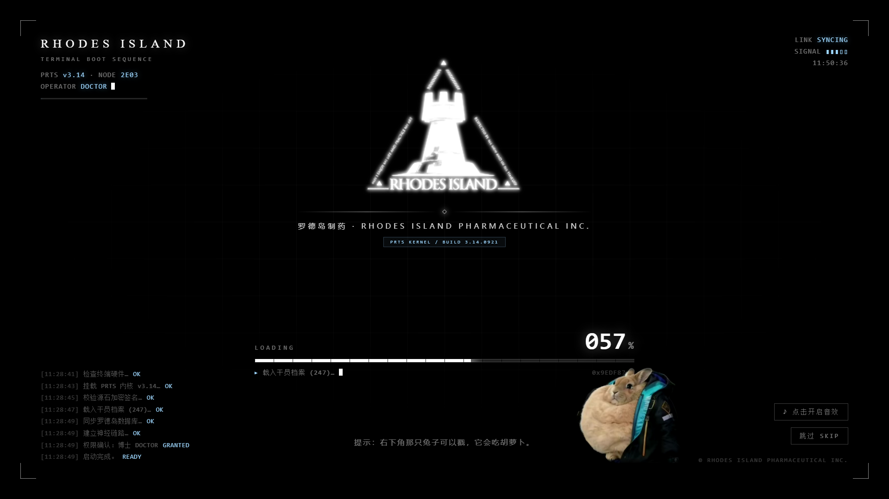
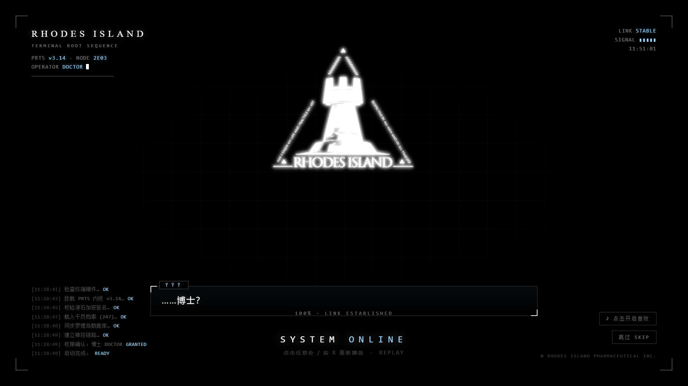
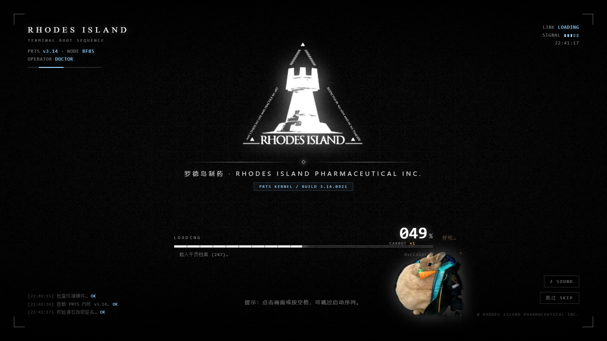

# 罗德岛启动动画 · RHODES ISLAND BOOT SEQUENCE

仿明日方舟加载界面的开场动画：纯黑底 + 扫描线 + 三色错位故障 + 逐段进度条 + 终端日志，
加载完成后第二张图里的兔子会跳到屏幕中央登场，最后收在 `SYSTEM ONLINE`。

> 已经作为 DSH 插件装进了 desktop profile：**每天第一次打开 Harness 会自动播一次**，
> 进度按真实网络状况走，约 10.5s 后自动淡出。见 [`../rhodes-boot-plugin/`](../rhodes-boot-plugin/README.md)。
> 本目录是独立网页版（双击 `index.html` 或单文件 `../rhodes-loading-standalone.html`），和插件版是同一套动画。


| 启动瞬间 | 兔子登场 | 结束页 |
| --- | --- | --- |
|  |  |  |

## 怎么打开

- 直接双击 `rhodes-loading/index.html`（推荐改代码时用这个）
- `../rhodes-loading-standalone.html` 是**单文件版**：CSS / JS / 图片全部内联，
  发给别人、丢到任何地方都不会丢图，双击即播

整个动画按 1920×1080 设计，会自动等比缩放铺满任意窗口，全屏播放效果最好（F11）。

## 操作

| 操作 | 效果 |
| --- | --- |
| 点击画面 / 空格 / 回车 | 跳过启动序列；已经播完时 = 重新播放 |
| `R` | 重新播放 |
| `M` | 音效开关（浏览器要求先点一下页面，声音才会出来，按钮会提示） |
| 右下 `跳过 SKIP` | 直接进结束页 |
| 右上 `♪ SOUND` | 音效开关 |

音效是现场用 WebAudio 合成的：低频底噪 + 打字滴答 + 落地闷响 + 充能 + 结束和弦 + 啃胡萝卜的脆响，没有外部音频文件。

## 兔子和胡萝卜

加载过程中兔子会**随机掏出一根胡萝卜啃**（每 3～6.6 秒一根，一根啃 3～5 口：一口一个脆响、
胡萝卜越啃越短、嘴边冒橙色碎屑、飘一句「咔嚓♪」，右上角的 `CARROT ×N` 计数 +1）。

**戳它也会吃**：加载过程中点兔子 = 立刻喂一根；这时点击不会触发"跳过"（终章和结束页点它才会跳过/重播）。
鼠标移上去兔子会亮一点，光标变手型，一看就知道能戳。



胡萝卜是 `index.html` 里一段内联 SVG（矢量、随便放大），想换橙色/绿色直接改 `carrotGrad` 和那几个
`ellipse` 的 `fill`。想调整手感的开关：

```js
carrot: true,                 // 关掉就没有胡萝卜
carrotInterval: [3000, 6600], // 随机啃一根的间隔(ms)
carrotBites: [3, 5],          // 一根啃几口
carrotWords: ['咔嚓！', '咔嚓♪', '嚼嚼嚼', '好吃…', '唔姆'],   // 飘字
```

## 想改成自己的东西

**文字/流程**：全部集中在 `app.js` 最上面的 `CONFIG` 里。

```js
rabbitMode: 'companion',  // companion 全程陪着加载 / jumpscare 最后突然糊脸 / off 不要兔子
sound: true,
carrot: true,             // 胡萝卜小剧场
tips: [...],              // 底部轮播提示
logs: [...],              // 左下终端日志：[文案, 标签, 第几毫秒出现]
dialog: [...],            // 兔子登场时的对话（名字 + 逐字打出的台词）
segments: [...],          // 进度条分段：at=第几毫秒开始、to=到多少、dur=花多久、stall=卡不卡
```

### 时间线是统一的一套（重要）

动画里出现的所有"时间"都从同一个基准推算，改的时候只改**毫秒偏移**这一个数：

| 位置 | 写法 | 含义 |
| --- | --- | --- |
| `logs` 第 3 个元素 | `['检查终端硬件…', 'OK', 250]` | 启动后第 250ms 打出这条日志 |
| `segments` 的 `at` | `{ at: 1700, to: 33, dur: 900 }` | 第 1700ms 开始，用 900ms 爬到 33% |

右上角那个时钟**不是真实系统时间**，而是"启动后经过的动画时间 × 2.15"（`CLOCKSCALE`）——
这样 10.5 秒的动画在屏幕上会走过约 22 秒，看起来像一段真实的开机过程，
而且日志里的时间戳和时钟永远对得上，不会出现"时钟 22:41、日志 22:40"这种事。

`segments` 的 `at` 你可以不写：不写就按顺序用前面的 `dur` 累加，行为和老配置一致。

**配色/尺寸/动效**：`style.css`，关键变量在最上面的 `:root`（`--ink` 主色、`--tech` 科技蓝）。
故障动画是 `logo-slam` / `logo-glitch`，兔子动作是 `hop` / `wobble` / `chomp` / `ring`。

**换图**（保持文件名即可，别的不动）：

- `assets/rhodes.png`：白色 logo + 透明背景（现在的图就是从你给的第一张图里抠出来的）
- `assets/rabbit-cut.png`：去背的兔子，PNG 带透明通道
- `assets/rabbit.jpg`：黑底原图，是兔子图加载失败时的备用

**网址参数**（不改代码先试效果）：

```
index.html?rabbit=jumpscare      兔子改成最后糊脸登场
index.html?rabbit=off            这一段不要兔子
index.html?carrot=0              不要胡萝卜小剧场
index.html?sound=0               静音
index.html?at=8300               定格在启动后第 8300ms（调时间轴 / 出预览图用）
```

`?at=` 会让它在那一毫秒停住（停掉所有动效与后续定时器），方便对准某一帧看构图。
注意它只是"停住"，不是拼接状态，所以**得在真实浏览器里看**；
无头浏览器（headless）的虚拟时间会干扰 setTimeout，定格点可能不准。

**控制台小手柄**（F12 里敲）：

```js
RHODES.eat()                           立刻喂一根胡萝卜
RHODES.play()  /  RHODES.skip()        重播 / 跳到结束
RHODES.config.carrotInterval = [600, 1200]   让它疯狂吃
```

## 文件结构

```
rhodes-loading/
├─ index.html         页面结构
├─ style.css          全部样式与动效
├─ app.js             时间轴 / 音效 / 粒子
├─ assets/            图片资源
├─ preview/           预览截图
└─ tools/build_standalone.py   改完源码后重新生成单文件版
```

改完 `index.html / style.css / app.js` 后想更新单文件版：

```powershell
python rhodes-loading/tools/build_standalone.py
```
