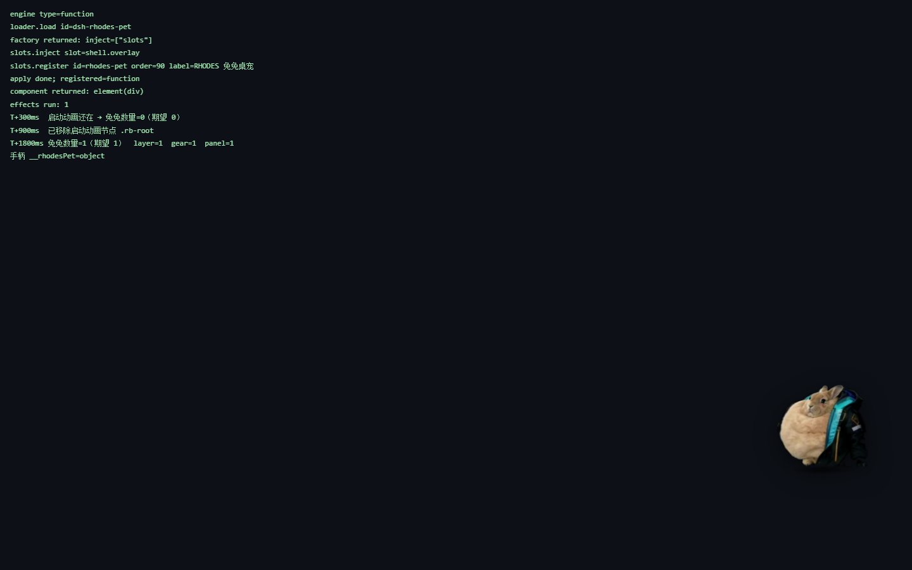

# dsh-rhodes-pet

DSH 的**罗德岛兔兔桌宠**插件：一只浮在 Harness 界面上的兔兔，能拖、能摸、能喂胡萝卜、点它会说话，带设置面板。

和 `dsh-rhodes-boot`（启动动画）配套：**启动动画播完、`rb-root` 退场之后，兔兔才出来**，
衔接就是"那只兔子从启动画面里留了下来"。



## 它做什么

- **拖动换位置**，位置记在 `localStorage`（`dsh-rhodesPet.config`），下次打开还在那儿
- **一个手势只做一件事**（刻意如此，详见 [`../rhodes-pet/README.md`](../rhodes-pet/README.md) 的「操作」）：
  - **单击 = 摸它**：合成触摸音（按戳的位置左右偏）+ 青色飘词 + 抖耳朵 + 轻跳。**不再随机喂食**
  - **把胡萝卜拖到它嘴边松手 = 喂它**：鼠标移到兔兔身上，右侧出现一个装胡萝卜的小圆盘，
    按住拖到它身上松手即可（光标进入范围时兔兔会亮一下）。右侧放不下时把手会翻到左侧
  - **双击 = 让它说话**；**右键 / ⚙ = 设置面板**
- **喂胡萝卜**：胡萝卜递到嘴边、一口一截越啃越短、橙色碎屑四散、啃完冒一句「吃完了！」
- **设置面板**（右键 / 齿轮按钮）：大小、透明度、音量、音效、自己溜达、跟着鼠标、点击说话、自动吃胡萝卜
- **等级与好感**：吃胡萝卜涨等级（Lv.1~10、称号、**静默解锁新台词**、身上的暖光、走得更稳）；
  摸它 / 说话 / 喂食涨好感（5 个亲密度阶段，好感高了更容易冒软话）。面板底部有两条进度条，
  升级会闪一下暖光、弹气泡、放一声三音上行，并派发 `rhodes-pet:levelup` 事件。
  数值细节见 [`../rhodes-pet/README.md`](../rhodes-pet/README.md) 的「等级与好感」。
- **跟着鼠标**（可选，默认关）：打开后兔兔**在光标附近随机游走**（不是粘着光标）。
  和"自己溜达"**双向互斥**，开一个会自动关另一个。
- **每日签到 + 今日补给库存**：换天后的第一次加载自动签到，补给补满 **325 根**，
  弹一句「签到完成 · 今日补给 ×325 已到位」；当天内每吃一根扣 1，吃空就喂不动。
  和启动动画共用 `dsh-rhodesPet.supply` 这个 `localStorage` 键（两边都能扣、都能签到），
  所以启动动画终章那句「胡萝卜 ×N」是真的在变。只装桌宠不装启动动画也不影响，反之亦然。
- **待机小动作**：一直呼吸起伏；静置久了会飘一句 `（发呆中）`；开着溜达时会自己横向挪一段

**不会挡住界面**：只有兔兔本体、胡萝卜、气泡、设置面板接住点击，其余全是 `pointer-events:none`。

## 什么时候出场

默认 `waitForBoot: true`：用 60ms 的短轮询盯着 `bootBusySelectors`（默认 `['.rb-root.rb-active', '#rb-boot-cover']`）。
所以：

- 启动动画还在播 → 兔兔不出现（不会跟动画叠在一起）
- 启动动画**退场、并且淡出干净**之后 → 兔兔出场
- 压根没装启动动画 / 找不到那些标记 → **立刻**出场（不白等）
- 兜底：最多等 `maxWaitMs`（默认 15s），超时也出场

### 两个坑，都踩过

**坑一：判断依据不能是"节点还在不在"。**

必须是**"正在播"的标记**（`.rb-root.rb-active`）。boot 的 `dismiss()` 只做两件事：
给 `.rb-root` 加 `rb-fadeout`、摘掉 `rb-active` —— **节点本身一直留在 DOM 里**，
要等 React 卸载组件时才 `remove()`。
第一版按"节点消失"判断，那个条件几乎永远不成立，
兔兔实际是被 `maxWaitMs` 兜底放出来的 —— 表现是"打开后要等一分钟才出现"。

**坑二：退场 ≠ 已经消失，中间差着一次淡出。**

摘掉 `rb-active` 只是**开始淡出**，画面还要 **600ms** 才淡干净
（`.rb-root.rb-fadeout .rb-stage{transition:opacity .6s ease}`）。
只按坑一修完，兔兔就会在**动画正在淡出**的时候冒出来 ——
用户看到的是"启动动画快结束了，桌宠就已经出现了"。
所以"不忙"之后还要再等一个 `bootFadeMs`（默认 700ms，略大于 600ms）：

    if (!busy) {
      if (!sawBoot) { spawn(); return; }                        // 没装动画 → 立刻出
      if (!bootClearedAt) bootClearedAt = Date.now();
      if (Date.now() - bootClearedAt >= SETTINGS.bootFadeMs) { spawn(); return; }
    }

`sawBoot` 用来区分"见过动画在播"和"这台机器没装动画"，后者直接出场、不白等。

> boot 那边有一条 `suppressOthers` 会把画面上的挂件压到淡出结束，
> 但它的白名单里**只有余额鲸鱼挂件、没有桌宠** —— 而且出场时机本来就该由桌宠自己负责，
> 所以没去动它的白名单。

另外等待循环用的是 `setTimeout` 而不是 `requestAnimationFrame`：实测 rAF 在这里的调度时机不可靠，
拿它做等待循环会导致兔兔永远不出来（踩过）。

### 出场动画：淡入（不是落地）

出场是 **140ms 淡入 + 从下往上 16px 的轻微上浮**（`fadeInMs`）。

> 落地动画只留给"拖动松手"（抓取-落地是一组动作），出场再用一次就重复了。
> 落地的实现还留在 `pet.js` 里，`?land=` 与 `RHODES_PET.drop()` 仍可用于调试。

落地那套的实测位置曲线（`?probe=land`，现在只有调试入口会走到）：

```
top: 435 → 448 → 476 → 517 → 568 → 612 → 607 → 603 → 602
     ^在落点上方 167px   ^下坠加速  ^压过头 10px ^回弹归位
```

> 落地动画刻意用 `setTimeout` 驱动而不是 `requestAnimationFrame`：
> rAF 在无头浏览器里不会被持续调度（这个项目踩过两次），而"加载完立刻要看到"的东西
> 不能依赖调度时机。时序本身用 `performance.now()` 算，所以掉帧也不会变速。

参数在 `client.js` 顶部的 `SETTINGS`：

```js
waitForBoot: true,
bootBusySelectors: ['.rb-root.rb-active', '#rb-boot-cover'],
bootFadeMs: 700,        // 退场后再等一个淡出时长，见上面的"坑二"
startDelayMs: 0,        // 启动动画一退场就出场，不再额外等待
maxWaitMs: 15000,       // 等待上限（第二道保险）
landMs: 0,              // 0 = 出场不用落地（落地只留给拖动松手）
dropFrom: 0,            // 下落高度；0 = 按窗口高度自动取（约 22vh、最多 220px）
fadeInMs: 140,          // 出场淡入时长（landMs 为 0 时生效）
```

## 控制台手柄

```js
__rhodesPet.feed()          // 喂一根胡萝卜
__rhodesPet.talk()          // 让它说话
__rhodesPet.touch()         // 摸它一下
__rhodesPet.openPanel()     // 打开设置面板
__rhodesPet.config          // 改配置（比如 __rhodesPet.config.size = 220）
__rhodesPet.state           // 运行状态
__rhodesPet.dispose()       // 卸载（等同插件卸载时做的事）
```

## 实现位置

- 渲染位置：Client `shell.overlay`（整帧悬浮层），注册 id `rhodes-pet`、order `90`。
- 样式全部限定在 `.rp-layer` 内（类名 `rp-*`），不写宿主的数据、不依赖宿主的内部状态。
- 面板挂在图层上而不是兔兔节点上：兔兔节点带 `transform`，会改变后代 `position:fixed` 的包含块，
  面板跟着兔兔偏移时会被顶出屏幕（这个坑踩过）。
- 生命周期：React `useEffect` 的清理函数里调 `pet.dispose()` —— 清定时器/rAF、摘全部监听、关 AudioContext、移除节点。

## 构建与安装

**不要直接改 `client.js`** —— 它是由引擎生成的。改 `../rhodes-pet/pet.js`（网页版和插件版同一个源），然后：

```powershell
# 1) 重新生成 client.js（内联图片、去掉网页版的自动挂载）
python rhodes-pet-plugin/tools/build_plugin.py

# 2) 自检产物是否自洽
python rhodes-pet-plugin/tools/check_build.py

# 3) 打包
cd rhodes-pet-plugin
pnpm pack --pack-destination ..
# 产出 dsh-rhodes-pet-1.23.0.tgz

# 4) 放到稳定目录并安装（别用 link:，pnpm 会穿过 junction 删源码，boot 插件踩过这个坑）
copy dsh-rhodes-pet-1.23.0.tgz %USERPROFILE%\dsh-bundles\
# dsh plugin --profile desktop add %USERPROFILE%\dsh-bundles\dsh-rhodes-pet-1.23.0.tgz
```

**客户端插件的改动需要重启 Harness 才会生效**（不是刷新页面就够）。

### 装之前先自己验一遍

`_test_host.html` 是一个**不依赖 Harness 的宿主模拟页**：它用极简 React 替身和 `__ModuleLoader__` 替身
把 `client.js` 真正加载一遍，然后检查：

- 模块加载 / `factory` 返回值 / 注册到 `shell.overlay` 是否都正常
- **启动动画节点还在时兔兔数量必须是 0**
- 把 `.rb-root` 移除后，兔兔数量必须变成 1
- 手柄 `__rhodesPet` 是否挂上

跑法（要有个本地服务，file:// 下子资源加载受限）：

```powershell
python -m http.server 8899 --bind 127.0.0.1 --directory <工作区>
# 浏览器打开 http://127.0.0.1:8899/rhodes-pet-plugin/_test_host.html
```

页面左上角会实时打印检查结果，全绿再装。

## 已知边界

- **只能活在 Harness 窗口内**。它是 `shell.overlay` 上的浮层，跟着窗口走，
  不会跑到桌面上、也不会在 Harness 最小化后还留在屏幕上。
  想做成"整个 Windows 桌面的独立桌宠"得另开一个 Electron 透明置顶窗口，那是另一个程序。
- 位置按视口坐标存。窗口变得比记录的位置小很多时会被夹回可视区（不会跑到屏幕外），
  但不会自动"按比例"重新布局。
