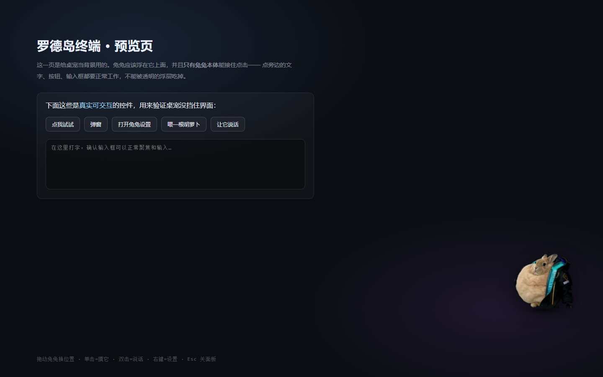
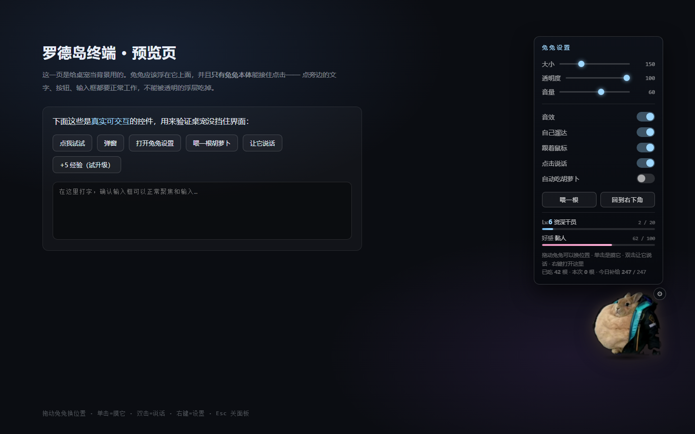
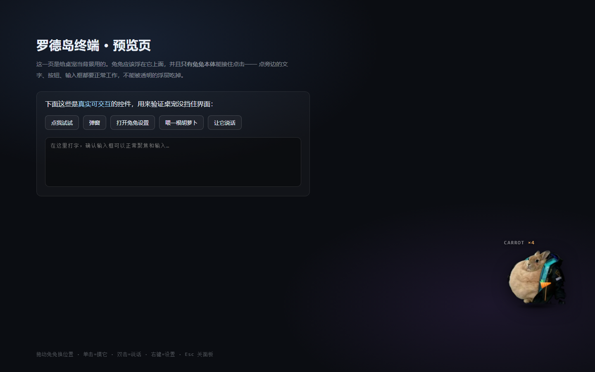
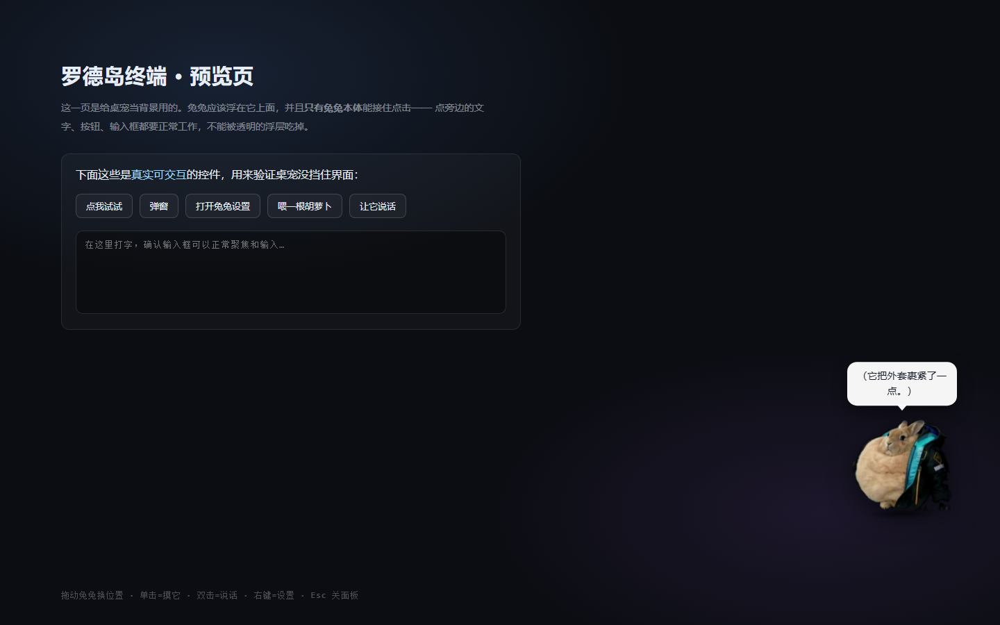

# 罗德岛兔兔桌宠 · RHODES PET

启动动画里那只兔子，留下来当桌宠了。

浮在 Harness 界面上的兔兔：**能拖、能摸、能喂胡萝卜、点它会说话**，右上角齿轮打开设置面板。
和启动动画共用同一张素材、同一套合成音效（WebAudio 现场合成，没有音频文件）。



| 设置面板 | 喂胡萝卜 | 点它说话 |
| --- | --- | --- |
|  |  |  |

## 怎么打开

- 直接双击 `rhodes-pet/index.html`（背景是块假界面，用来验证桌宠不挡操作）
- 想装进 Harness 当桌宠 → 见 [`../rhodes-pet-plugin/`](../rhodes-pet-plugin/README.md)

## 操作

**一个手势只做一件事**——这是刻意设计的：早先"单击"有 45% 概率顺手喂食，
而双击由两次单击组成，于是双击大约 70% 会喂食。同一个手势时灵时不灵，
用户没法预期点了会怎样，点击就变得不可信。

| 操作 | 效果 |
| --- | --- |
| 单击 | **只摸它**：触摸音 + 飘词 + 抖耳朵 + 轻跳。确定、可预期 |
| **把胡萝卜拖到它嘴边松手** | **喂它一根**（见下） |
| 双击 | 让它说话（随机台词气泡） |
| 右键 / 右上角 ⚙ | 打开设置面板（⚙ 鼠标移上去才显示） |
| 拖动兔兔 | 换位置（**松手时有一记落地**，见下），位置会记住（存在 `localStorage`） |
| `Esc` | 关设置面板 |

### 出场：快速淡入（不再用落地）

出场是 **140ms 淡入 + 从下往上 16px 的轻微上浮**（`fadeInMs: 140`）。

> **落地动画只保留给"拖动松手"。** 出场原本也用落地（从上方 22vh 落下来接住启动动画
> 里退场的那只兔子），但两处落地的手感重复了，所以出场改回很轻的淡入。
> `playDrop()` 的实现还在，`?land=` 与 `RHODES_PET.drop()` 仍可用于调试。

**⚠ 触发那一步不能只挂 `requestAnimationFrame`。**
实测（无头/节流环境下）rAF 可能完全不调度，于是回调里的 `opacity = ''` 永远不执行，
兔兔就卡在 `opacity:0` —— **整个桌宠不可见**。这不是"动画不好看"，是功能没了。
所以 `playAppear` 现在是三层保险：

1. `requestAnimationFrame(start)` —— 正常路径
2. `setTimeout(start, 32)` —— rAF 不跑时的保险
3. `setTimeout(..., fadeIn + 200)` —— 兜底：无论如何把它变成可见并归位

验证（`_fade.html`）：内联 `style.opacity` 最终为 `""`（=回到默认 1）、
`transform` 精确归位、且确实经历过隐藏阶段。

> 注意：无头环境**不渲染帧**，CSS transition 不会推进，`getComputedStyle().opacity`
> 会一直停在起始值 0。判定要看**内联样式**，不然会误判成"兔兔不可见"。

### 拖动松手：抓取-落地

`playDrop(240, 26)` —— 240ms、落差 26px：提起放下的一记轻"啪"。

前 60% ease-in 下坠（同时轻微拉长）→ 后 40% **压扁 + 阻尼回弹**。

实测位置曲线（`?probe=dragdrop`）：

```
松手后 top: 516 → 519 → 527 → 555 → 547 → 543 → 542
            ^松手处  ^下坠   ^压过头13px ^回弹归位到落点
```

> 落差给小、时长给短是刻意的：拖动是高频操作，动作必须短促；
> 用大落差会变成慢悠悠飘下来，不像"放下"。

### 拖胡萝卜喂食

喂食是个**有意为之**的动作，不再挂在摸头上随机触发：

1. 鼠标移到兔兔身上，它**右侧**出现一个装着胡萝卜的小圆盘（把手）
2. 按住那个圆盘往兔兔身上拖 —— 光标进入它的范围时兔兔会**亮一下**，表示"松手就能喂到"
3. 松手：喂成功 / 拖到空处则把手飞回原位

**面板里的「喂一根」也是引导拖拽**：点它会**关掉面板 + 把把手显示出来**
（因为面板会挡住兔兔，关掉才看得见喂食动作），然后你把它拖过去喂。
想"点一下立刻喂"的话，用设置里的**自动吃胡萝卜**开关。

细节：把手默认在右侧；**右侧放不下时会翻到左侧**（兔兔常待在右下角，右侧本来就没空间，
不翻边的话把手会被视口裁掉）。

> ⚠ 把手**必须是 `.rp-pet` 的子元素**：显示规则用的是 `.rp-pet:hover .rp-offer`（后代选择器），
> 挂在 `.rp-layer` 这类外面就永远不匹配、把手始终 `opacity:0`，用户根本看不到它。
> 这个错曾经存在过很久没被发现，因为测试都用 `?offer=1` 强制显示，**绕过了 hover 这条路径**。
> 所以它挂在兔兔内部、用相对兔兔的**局部坐标**定位（兔兔移动时把手自动跟随）。
> 定位和面板相反：面板是 `position:fixed` + 视口坐标（必须挂 layer，否则会被兔兔的 transform 带偏）。

### 点击面板外任意位置 = 关闭面板

`Esc` 能关，**点击屏幕上任何别的地方也能关**。

实现上有个坑：这个监听必须注册在**捕获阶段**（`addEventListener('pointerdown', fn, true)`）。
DSH 界面里的元素（React 组件、输入框、各种挂件）可能在冒泡阶段调 `stopPropagation`，
挂在冒泡阶段就收不到事件 —— 表现就是"面板打开后点别处关不掉"。
捕获阶段在事件往下传时就触发，不受子元素 `stopPropagation` 影响。

**只有兔兔本体、胡萝卜把手、气泡、面板会接住点击**，其余区域全部 `pointer-events:none`——
所以它浮在界面上不会挡住任何按钮和输入框（预览页里那几个真控件可以点着验证）。

## 它会自己做什么

- **呼吸**：一直轻微起伏，不动的桌宠像贴图
- **溜达**：默认开着，偶尔自己横向挪一段（可在设置里关掉）
- **发呆**：静置久了会飘一句 `（发呆中）` `zzz……` 之类
- **自动吃胡萝卜**：默认关，打开后隔 9~22 秒自己掏一根

## 设置项

齿轮面板里可调，全部即时生效并持久化。

### 面板结构：状态常驻 + 设置折叠

**等级 / 好感 / 胡萝卜是常驻的**，就钉在标题下面，不折叠、也不受滚动影响：

```
兔兔设置
Lv.6 资深干员                 2 / 20     ← 经验进度条
好感 黏人                    62 / 100    ← 好感进度条
胡萝卜 今日 0 · 共 50 · 存 50    已吃 42
────────────────────────────────────
外观   / 行为   / 数据            ← 这三组可折叠
```

> 这一条很关键：状态块早先被放在"状态与数据"折叠组里，于是展开设置项之后它
> 就被推到可视区外面 —— 用户会以为"等级、好感、今日补给都没了"。
> **状态是"想随时看一眼"的东西，不该和设置项一起折叠。**

设置部分按高度限制（`max-height: 72vh` + 内部滚动），分**两组可折叠**，另外底部有排按钮：

| 位置 | 内容 |
| --- | --- |
| 外观（折叠组） | 大小 / 透明度 / 音量 |
| 行为（折叠组） | 音效 / 自己溜达 / 跟着鼠标 / 点击说话 / 自动吃胡萝卜 |
| 底部按钮 | 喂一根 / 回到右下角 / 清空数据 |

两组默认**全展开**；面板限高 72vh，装不下就出现滚动条（鼠标滚轮/拖动条都能滚）。

> 早先还有个「数据」折叠组（装着一段"清空数据会归零什么"的说明 + 按钮）。已经**去掉**：
> 那段说明是在解释"为什么不显示本次会话计数"，属于写给开发者的内容，对用户零价值还占四行。
> 「清空数据」按钮**保留**（它是"想重新开始 / 数据出问题"时的逃生舱口），但挪到了面板最底部，
> 不再单独占一个分组。

| 项 | 范围 | 写在每一项下面的说明 |
| --- | --- | --- |
| 大小 | 80~320px | 兔兔显示成多大（80~320px） |
| 透明度 | 25%~100% | 嫌它抢眼就调低，25% 时几乎只剩个影子 |
| 音量 | 0~100% | 只是音效的音量，跟系统音量无关 |
| 音效 | 开关 | 关掉后摸它、啃胡萝卜都不出声，也不会占用音频通道 |
| 自己溜达 | 开关 | 隔一会儿自己横向挪一段；和"跟着鼠标"只能开一个 |
| 跟着鼠标 | 开关 | 在光标附近随机走动并停下歇会儿，不会贴着光标挡你看字 |
| 点击说话 | 开关 | 双击冒一句台词气泡；关掉后双击就没反应了 |
| 自动吃胡萝卜 | 开关 | 隔 9~22 秒自己掏一根啃，会扣今日胡萝卜 |
| 喂一根 / 回到右下角 | 按钮 | 手动投喂、把兔兔挪回右下角 |
| 清空数据 | 按钮 | 清掉等级/好感/吃掉的数量/胡萝卜库存/位置（会先弹确认） |

### 说明为什么直接写在下面（而不是"悬停才显示"）

每项都有一句说明——只写"跟着鼠标""自动吃胡萝卜"这种名字，用户没法知道点下去会发生什么。

**试过"悬停才显示"（浮层），已放弃。** 原因有两条：

1. **悬停说明是个"看不见的功能"**：用户不知道要悬停就永远不会悬停。
   为了补救，还得在面板底部常驻一句"鼠标指到设置项上可以看到说明 · 点这里让它常显"，
   等于绕一圈才把信息给出去。
2. 那个"常显"按钮本身就是多余的复杂度。

**结论：直接摊开。** 代价是内容变高——那就让面板限高 + 滚动，这是更简单的取舍。

实测（三组全展开）：

| 窗口高 | 面板高 | 内容高 | 可滚动 |
| --- | --- | --- | --- |
| 916 | 548px | 809px | **是** |
| 700 | 395px（被 72vh 截住） | 809px | **是** |

滚动条做了三件事让"能滚动"这件事可见：
- `scrollbar-gutter: stable` —— 滚动条槽位常驻（macOS 默认是 overlay，不用就看不见）
- `::-webkit-scrollbar` 给了 7px 宽和可见的滑块颜色
- 内容区底部 `mask-image` 渐隐，滚到底时用 `.rp-atend` 取消

> 展开/收起分组会改变面板高度，所以**必须重新夹取位置**（`placePanel()`），
> 否则位置还是按旧高度算的，展开后下半截会跑到屏幕外。
> 另外展开时会**钉住当前最靠上的那个标题**（`keepAnchor`），不然展开一个长分组
> 会把上面的内容顶走，看起来像"点错了"。

**自己溜达 / 跟着鼠标互斥**：开一个会自动关另一个（详见下文）。

### 跟着鼠标

**跟着鼠标 ≠ 粘着鼠标。** 打开后兔兔会**在光标附近随机游走**，而不是贴着光标走：

1. 在光标附近**随机挑一个落脚点**（方向随机、距离 120~320px，不是光标本身）
2. 限速平滑走过去（190px/s，所以是有惯性的移动，不会瞬移）
3. **到了就停一会儿休息**（0.5~1.8s）
4. 休息完、或光标跑出 420px 太远 → 重新挑一个落脚点

因为落脚点是随机挑的，"兔兔的路径可以随机"，表现出来是**折线 + 停顿的游走**，
而不是一条直线扑向光标。效果：它始终在光标附近（实测 77% 的时间在 420px 内），
但只有 10% 的时间真的压在光标上——所以不会挡住你正在看的文字。

如果改成每帧朝光标做指数平滑，它会永远悬在光标某个角上黏着不放，那就是另一种东西了。

细节：鼠标位置只在开关打开时记录；拖动兔兔时跟随暂停；落脚点与位置都夹在可视区内。

**两个移动模式是双向互斥的**：开"跟着鼠标"会自动关"自己溜达"，反过来也一样。
（只做单向是不够的——"跟随着开着时去开溜达"会让两个都亮着，而循环里跟随优先，
那个刚点亮的溜达开关其实毫无作用，属于骗人的 UI。）

参数在 `pet.js` 的 `FOLLOW` 里：`distMin` / `distMax`（落脚点距离范围）、`speed`（限速）、
`respawnDist`（多远算掉队）、`restMin` / `restMax`（休息时长）、`retargetMin` / `retargetMax`（换点间隔）。

## 每日签到 与 胡萝卜

### 签到

**换天之后第一次加载自动签到**：今日配额 **+50 根**，并在**兔兔出现的那一刻**弹一句气泡
「签到完成 · 今日 +50 根 · 共 100 根」，同时飘一句 `签到 +50`。

签到**每天只发生一次**。报完提示后程序会把 `gain` 清零，所以**同一天再次打开不会再弹一遍**。

#### 提醒为什么必须挂在"出场时刻"上

早先用的是固定延时 `setTimeout(announceCheckIn, 900)`，那是错的：

插件是在**等启动动画退场之后**才创建桌宠引擎的，等多久完全不确定
（正常几十毫秒；退场标记没等到就要一直等到 `maxWaitMs = 15s`）。
于是固定延时会出现两种情况：

- 等得久（比如 8 秒才出场）→ 气泡在**兔兔还没出现时**就弹完了，用户什么都看不到
- 等得短 → 兔兔出现后还要干等

现在引擎提供一个 `opts.onAppear` 回调，在**兔兔真正可见的那一刻**触发一次
（淡入走完 / 落地站稳，取先到者），签到提醒挂在它上面：

```js
opts.onAppear = announceCheckIn;
```

回调只触发一次（`appearDone` 守卫），并且有兜底：

| 路径 | 何时触发 |
| --- | --- |
| `playAppear(fadeIn, onDone)` | 淡入结束（含 rAF 不跑时的兜底） |
| `playDrop(ms, fromY, onDone)` | 落地站稳 |
| 无动画（直接出现） | 立刻 |
| `setTimeout(onAppeared, 2600)` | 兜底：动画万一没走完也要报一次 |

> 顺序有个坑：`announceCheckIn` 与 `opts.onAppear = …` 这两段必须写在
> **触发出场动画之前** —— 因为"直接出现"那条路径会**同步**回调 `onAppeared()`。
> 写成后面就会拿到 `undefined`，签到提醒静默失效（踩过，已调整顺序）。

验证：`?probe=checkin` 第 8 项用 MutationObserver 抓 DOM 里真正出现的气泡文字，
断言 `签到完成 · 今日 +50 根 · 共 100 根`。

启动动画终章那句会跟着变：

| 情况 | 说法 |
| --- | --- |
| 今天刚签到 | 「今日签到完成：补给 +50 根，共可喂 50 根。」 |
| 当天已经领过 | 「今日补给已领：还可喂 47 根。」 |

### 两个池子：今日配额 + 存货

| 字段 | 含义 |
| --- | --- |
| `quota` | 今日签到领到、**还没吃掉的**（换天重新签到后回到 50） |
| `stock` | 累积存货，硬上限 **10000** |

**喂食顺序：先吃今日配额，吃完再吃存货**——"今天的先用掉，存粮留着"最直观，
也让"今天还剩几根"这个数有意义。吃得掉的会真的变少。

面板底部显示两个**不重叠**的数：

```
胡萝卜：今日 48 根 · 共 98 根（含存货 50）
```

- **今日** = 今天签到领到、还没吃的
- **共** = 今天一共还能吃多少（今日 + 存货）；吃一根它一定变小
- 有存货时才显示括号里那句，存货为 0 时不显示，免得出现"今日 48 · 共 48"这种啰嗦

> 早先这里显示的是「今日配额」和「库存（含今日剩余）」，**同一个数被算了两次**：
> 吃胡萝卜时"库存"那个数纹丝不动，看着像两个互不相干的池子。现在是两个不重叠的口径。

### 闸门

扣到 0 就**喂不动了**（提示「胡萝卜吃完了，明天签到会补 50 根」）。
所有喂食路径都要过这一关：

| 喂食路径 | 扣减 |
| --- | --- |
| 桌宠：**把胡萝卜拖到它嘴边**松手 | ✓ |
| 桌宠：面板里点「喂一根」 | ✓ |
| 桌宠：开着"自动吃胡萝卜" | ✓ |
| 启动动画：戳那只兔子喂一根 | **✗ 不扣** |

（单击"摸头"**不**喂食——喂食只有上面那几条明确路径。）

### 与启动动画的边界：胡萝卜只由桌宠管

供应记录存在 `localStorage` 键 `dsh-rhodesPet.supply`（同一台机器、同一个 origin）：

```js
{ day: '2026-10-11', quota: 46, stock: 812, checked: true, gain: 0 }
```

**启动动画对它是只读的**，`dsh-rhodes-boot` 里没有 `supplyTake` / `supplyWrite`。

| | 启动动画 | 桌宠 |
| --- | --- | --- |
| 读供应记录 | ✓（终章那句报还剩几根） | ✓ |
| **写**供应记录（扣减 / 签到） | ✗ | ✓ |
| 等级、累计根数 | ✗ 完全无关 | ✓ |

**为什么这么切**：启动动画里戳兔子只是开场表演，不该是"消耗品"。
而且一旦两边都能写，就得连等级/累计一起考虑——两个插件各自独立打包、只能靠
同一条 localStorage 记录同步，很容易互相覆盖（试过一版"启动动画吃的也算经验"，
复杂度立刻上去了，收益却只是几根胡萝卜）。分工干净反而更省事：

> **启动动画负责好看，桌宠负责养成。**

只有 `supplyRead` 的读取逻辑两边各有一份（各自独立打包，不共享模块），
改签到/配额规则时两边都要改——注释里都标了。只装其中一个也能正常工作。

## 等级与好感

两个维度，分工不同：**等级是吃出来的，好感是陪出来的**。

| | 怎么涨 | 最高 | 给什么 |
| --- | --- | --- | --- |
| **等级** | 每吃一根胡萝卜 +1 经验 | **Lv.120** | 称号、**解锁新台词**、兔兔身上的暖光、溜达得更稳 |
| **好感** | 摸它 +1 / 跟它说话 +1 / 喂它 +1 | 100 | 亲密度称号、更容易冒出亲昵的话 |

### 等级：Lv.1 ~ Lv.120

上限是 **120 级**（对齐明日方舟的等级跨度）。经验曲线用**公式**算，不再手写数组
——手写 120 条太容易错，而且调曲线时要改 120 个数字：

```js
function needFor(i) {
  return i <= 20 ? (3 + 2 * (i - 1))    // Lv.1→20：每级 +2（3,5,7,…,41），前期升级快
                 : (41 + (i - 20));     // Lv.20→120：每级 +1（41,42,43,…）
}
```

累计经验（`CUM[i]` = 到达 i+1 级所需的经验）：

| 等级 | 累计经验 | 满速喂（每天 50 根） |
| --- | --- | --- |
| Lv.2 | 3 | 第 1 天 |
| Lv.10 | 99 | 第 2 天 |
| Lv.20 | 440 | 第 9 天 |
| Lv.50 | 2135 | 第 43 天 |
| Lv.80 | 4730 | 第 95 天 |
| **Lv.120** | **9590** | 约 6.4 个月 |

节奏参考游戏里的精英化：前期一天能升好几级（有反馈），越往后越久（是长期目标）。

### 六级颜色档（每 20 级换一档）

**每 20 级换一档，正好 6 档铺满 Lv.1 → Lv.120**，每档同时换**称号 + 辉光颜色 + 溜达速度**。

| Lv | 称号 | 辉光颜色 | 强度 |
| --- | --- | --- | --- |
| 1–20 | 临时登记 | 初识的浅蓝 | 0.22（几乎无光） |
| 21–40 | 后勤实习生 | 后勤的青 | 0.42 |
| 41–60 | 正式干员 · E0 | 制式的蓝 | 0.58 |
| 61–80 | 资深干员 · E1 | 精锐的紫 | 0.74 |
| 81–100 | 行动组队长 · E1 | 队长的绯 | 0.86 |
| 101–119 | 罗德岛王牌 · E2 | 王牌的暖金 | 1.00 |
| **120** | **首席胡萝卜官** | **首席的琥珀** | 1.00 |

颜色和称号**特意对齐**（同一档一起换）——只换颜色不换称号的话，玩家到了 60 级会觉得
"名字还是那个、只是颜色深了点"，反馈不完整。Lv.120 单独一档，当作满级彩蛋。

**辉光用 `drop-shadow` 画在素材外层**，不动图片本身——素材是一张真实兔子照片，
直接 `hue-rotate` 会把毛色也染坏。两道叠加：一道紧的做颜色边缘，一道松的做光晕。

强度是**实测调出来的**。第一版只给 0.10~0.62、模糊 7~20px，截图对比下来
"Lv1 与 Lv101 的最大像素差只有 62"（`(21,23,35)` → `(42,36,63)`），肉眼根本看不出换档。
加强后：

| 对比 | 最大像素差 | 取样点变化 |
| --- | --- | --- |
| Lv41 vs Lv1 | 65 | `(35,43,57)` → `(44,69,87)` |
| Lv61 vs Lv1 | 113 | `(35,41,55)` → `(63,76,105)` |
| Lv101 vs Lv1 | 151 | `(35,43,57)` → `(87,73,126)` |
| Lv120 vs Lv1 | **194** | `(34,42,57)` → `(148,105,40)` |

第 1 档只有 0.22 是刻意的：让"升级换色"从第 21 级才开始有存在感，前面留给"升级很快"的爽感。

**换档那一次升级会多说一句**：气泡显示两行，第二行是「新阶段 · 精锐的紫 · Lv.61~80」，
不然玩家只会看到 `Lv.61 · 资深干员 · E1`，不知道颜色也跟着变了。
面板的状态块里也常驻一行 `颜色阶段：Lv.61~80 · 精锐的紫（下一档 Lv.81）`。

### 好感阶段

| 好感 | 称号 |
| --- | --- |
| 0 | 刚认识 |
| 15 | 有点熟了 |
| 35 | 会跟着你 |
| 60 | 黏人 |
| 85 | 最信任你 |

### 解锁是"静默"的

不弹解锁提示、不加锁图标——**等级到了，对应台词自然就混进点击说话的池子里了**。
120 级跨度大，所以把解锁点铺开，别让中期一直没新东西：

| 需要 | 解锁的台词（示例） |
| --- | --- |
| Lv.2 | 「我记得你的手感了。」 |
| Lv.5 | 「今天也一起加油吧，博士。」 |
| Lv.12 | 「你不用一直看着我，我会待在这儿的。」 |
| Lv.25 | 「有什么事都可以跟我说，我记性很好的。」 |
| Lv.45 | 「（它把外套的一角搭在你的光标上，像是在牵着你。）」 |
| Lv.70 | 「……博士，谢谢你没有把我关掉。」 |
| Lv.95 | 「后勤·胡萝卜消耗股，随时待命。」 |
| Lv.118 | 「这个给你。反正你会再给我的，对吧？」 |

好感 ≥60 和 ≥85 时，亲昵的台词会被**加权**（在池子里多放几份），所以黏人之后更容易听到软话。

### 升级时会发生什么

1. 兔兔身上闪一下暖光（`rp-levelpop`）
2. 头上气泡显示 `Lv.N · 称号`
3. 一声三音上行的升级音（WebAudio 合成）
4. 气泡淡出**之后**再飘一句它自己的话
5. 面板里的进度条跟着走

升级还会派发一个 DOM 事件，方便以后接别的功能：

```js
window.addEventListener('rhodes-pet:levelup', (e) => {
  console.log(e.detail);   // { level, prevLevel, title, xp }
});
```

### 想改数值

都在 `pet.js` 顶部：`LEVELS`（经验线 + 称号）、`TIER_LOOKS`（每两级的暖光强度与溜达速度）、
`LOCKED_TALK`（解锁台词，`need` 是"到几级为止"）、`AFF_TIERS`（好感阶段）。
经验按"根"算而不是按"口"算——一口几顿是随机手感，拿来当经验会变成拼运气。

## 计数口径：只有"累计"

面板和兔子头上显示的都是**跨会话累计**（`eatCount`，存在 `localStorage`），关掉再开还在：

| 显示 | 含义 |
| --- | --- |
| 面板「胡萝卜 … 已吃 N」 | 累计吃过多少根 |
| 兔子头上 `CARROT ×N` | 同一个数，每 +1 会弹一下提醒你 |

**没有"本次会话"这个口径了。** 早先还有一个"本次 N 根"（这次加载之后吃了多少、
重开归零），但那是养成系桌宠里最容易误导的数字：**关掉再打开就变成 0，看着像掉档**。
已连同 `sessionCount` 一起移除。

## 存档与清空

本插件用到的全部 localStorage 键（集中在 `pet.js` 顶部的 `KEYS`）：

| 键 | 存什么 |
| --- | --- |
| `dsh-rhodesPet.config` | 大小/音量/开关/等级/好感/累计吃了几根/位置 |
| `dsh-rhodesPet.supply` | 每日签到 + 胡萝卜库存（**与启动动画共用**） |
| `dsh-rhodesPet.migrated` | 一次性迁移标记，见下 |

**清空数据**有三条路，效果一样（都会把上面三个键一起清掉）：

1. 设置面板底部的「清空数据」按钮（会先弹确认）
2. 控制台：`RHODES_PET.reset()`
3. 手动删键（或在控制台 `RHODES_PET.resetAll()`，不重载页面）

### 关于"每个用户的兔兔是独立的"

**`localStorage` 是按操作系统用户 + 应用隔离的**，所以每个人在自己电脑上打开 Harness，
拿到的本来就是一份独立的兔兔——等级、好感、胡萝卜库存互不可见，也不需要额外做"用户分区"。
换一台电脑、换一个 Windows 账号，读到的都是全新的空档。

### 一次性迁移清理（发给用户前清掉开发数据）

`pet.js` 里有个 `migrateOnce()`：用一个标记 `dsh-rhodesPet.migrated.v1` 保证
**只在本机清一次**。标记不存在 → 清掉全部存档并写标记；之后（包括用户升级到更新的版本）
永远不会再自动清，所以不会误删用户自己的数据。

这不是"每次启动都清零"——那种做法会把用户的进度一起抹掉。

## 台词 / 飘词怎么改

全在 `pet.js` 顶部的 `WORDS` 里，按情绪分了池、颜色也不同：

| 池 | 何时飘 | 颜色 |
| --- | --- | --- |
| `touch` | 摸它那一刻 | 青 |
| `bite` | 每啃一口 | 橙 |
| `mood` | 每口约 42% 概率 | 粉 |
| `finish` | 一根吃完 | 粉 |
| `talk` | 点它说话（气泡） | 白底气泡 |
| `idle` | 静置发呆 | 半透明白 |
| `levelup` | 升级气泡淡出之后 | 粉 |

加台词就往对应数组里塞一句，不用改别的。**升级解锁的台词**不在 `WORDS` 里，在 `LOCKED_TALK`（见上文）。

## 音效

`Sfx` 里七个声音，全是 WebAudio 现场合成（没有音频文件）：

- `touch()` —— 极短的绒毛摩擦 + 一声上扬的软「啾」+ 一点高频小天使粉；**按戳的位置左右偏**
- `grab()` —— **抓起兔兔**：「啵」地一下被提起来（绒毛摩擦 + 640→1180 上扬 + 1600 点缀）
- `put()` —— **放下兔兔**：软软落下去（760→360 下滑 + 240 低音「咚」+ 极轻触地）
- `crunch()` —— 每咬一口的脆响（带通白噪声 + 下滑方波）
- `happy()` —— 吃完一根的双音上行
- `blip()` / `pop()` —— 说话前轻叮 / 喂食时的弹跳音
- `levelUp()` —— 升级的三音上行 + 一层很轻的闪烁

### 抓取 / 放下音各自的触发点

| 音 | 什么时候响 | 什么时候**不**响 |
| --- | --- | --- |
| `grab()` | 拖动位移超过 4px、**确认是拖**的那一刻 | 只是单击摸头（那样听起来和"提起来"一样，会误导） |
| `put()` | 松手落地，和 `playDrop(240, 26)` 的落地动画**同时** | 没拖动的单击；拖了但没松手 |

听感上「落」和「响」是同一件事，所以两者必须同步触发，不能只做动画不配音。

浏览器要求先有交互才出声，第一次点页面会自动 `resume()`。

验证：`?probe=sound` 会把 `AudioContext` 换成假的，**靠振荡器被设定的频率特征认出响的是哪个音效** ——
抓取=640/1600、放下=760/240、摸头=760/1520（用 240 把"放下"和"摸头"区分开，两者都有 760）。
同时验证单击不会误响抓取/放下音。

## 文件结构

```
rhodes-pet/
├─ index.html          独立预览页（含一块假界面）
├─ pet.js              引擎：全部逻辑与样式都在这里
└─ preview/            预览截图
```

`pet.js` 是个工厂函数 `RHODES_PET_ENGINE(opts)`，返回
`{ feed, talk, touch, biteOnce, grantXp, grantAffection, levelInfo, config, state, openPanel, closePanel, dispose, reset }`。
直接引入它会自己 `document.body` 上起一只（独立预览页就是这么用的）；
插件版传 `{ container, debug:false, fadeIn:0 }`，由插件决定何时创建、何时 `dispose()`。

想快速试等级/好感，控制台里直接给：

```js
RHODES_PET.grantXp(20)          // 加 20 点经验，够跨两级
RHODES_PET.grantAffection(30)   // 加好感
RHODES_PET.levelInfo()          // { level, title, into, need, span, prog }
```

### 调试用网址参数

只在独立预览页生效（插件里 `debug:false`，宿主页面的参数不会影响桌宠）：

```
index.html?panel=1             直接打开设置面板
index.html?state=eat           定格在"刚掏出胡萝卜"
index.html?state=eat2          定格在"啃了两口"（验证越啃越短）
index.html?state=talk          定格在"正在说话"
index.html?state=touch         定格在"刚被摸到"（抖耳朵 + 飘词）
index.html?state=levelup       摆成"差一根升级"，然后真喂一根，走完整升级流程
index.html?freeze=1            停掉主动画循环（截图不抖）
index.html?notrans=1           关掉所有过渡（排查渲染问题时用）
index.html?scale=2.2           整体放大，方便看细节
index.html?fed=3               已吃计数摆成 3
index.html?xp=42&aff=62        等级经验 / 好感摆成指定值
index.html?supply=200          今日补给摆成 200
index.html?follow=1            打开"跟着鼠标"
```

还有几个自检探针（会往 `<title>` 里写结果，配合无头 `--dump-dom` 看）：

```
index.html?panel=1&probe=1            面板里的数字是否实时更新
index.html?panel=1&probe=level        等级/好感的数值、进度条、升级事件
index.html?follow=1&probe=follow      跟随是否真的在动、边界是否夹住
index.html?probe=ui                   把手 DOM 结构、面板点外关闭、点「喂一根」的行为
index.html?probe=sound                抓取/放下音效是否真的响、响的是哪个、单击不误响
index.html?probe=dragdrop             拖动松手有一记落地并归位
index.html?probe=checkin              每日签到 + 出场提醒
```

> `probe=sound` 会在 `pet.js` **之前**把 `AudioContext` 换成假的（引擎一加载就会抓住它），
> 靠记录**振荡器被设定的频率**来认出响的是哪个音效：抓取=640/1600、放下=760/240、摸头=760/1520。
> 用 240 把「放下」和「摸头」区分开——它们都有 760。

这些参数是开发这个桌宠时用来做无头截图的——状态是**真实状态**，不是手写的一份假样式，
所以截出来的就是实际播放效果。

> 关于 `probe=follow`：跟随是"每帧按 dt 靠近一点"的积分逻辑，而无头浏览器**不会持续调度
> `requestAnimationFrame`**（实测循环只跑 3 帧就停了），光靠等是验不出来的。
> 所以引擎对外暴露了一个 `RHODES_PET.step(dt)`，让自检能显式喂 dt 推进——
> 这也是为什么那个探针看起来像"手动走帧"。
