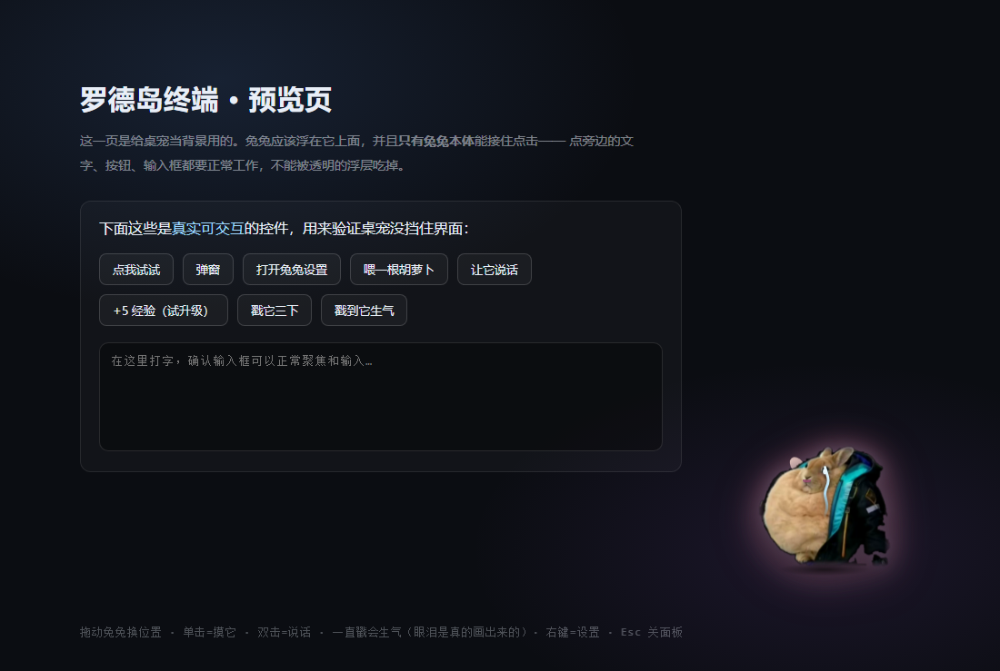
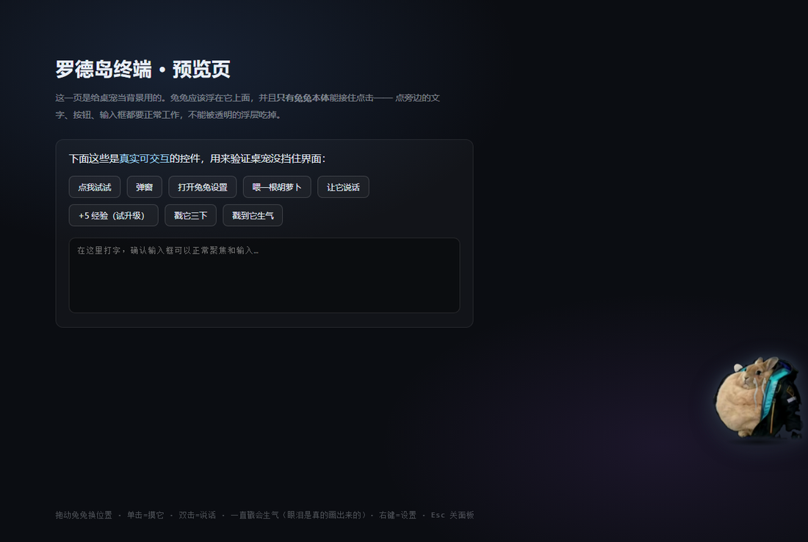
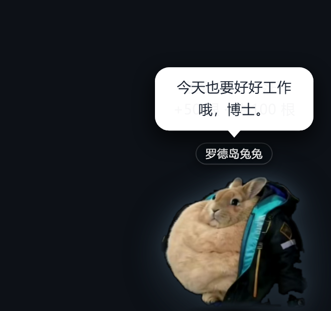
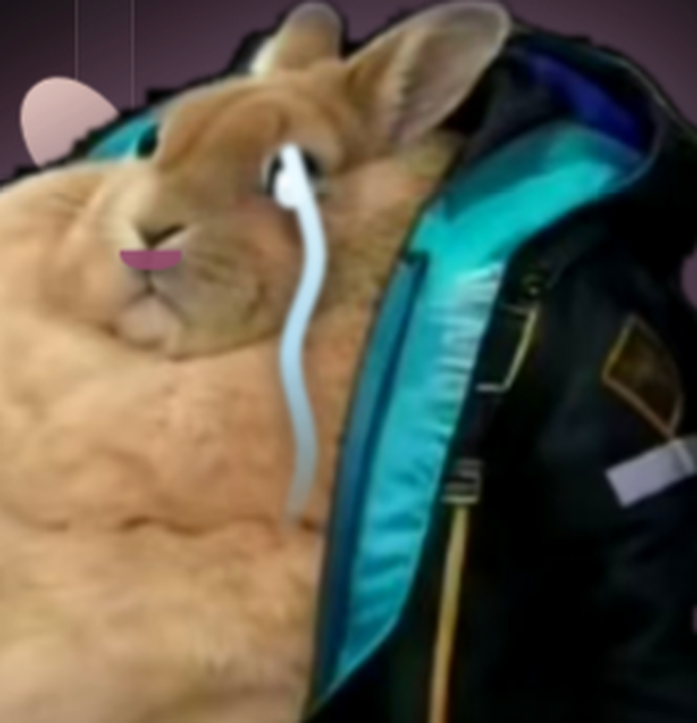

# 罗德岛兔兔桌宠 · RHODES PET

启动动画里那只兔子，留下来当桌宠了。

浮在 Harness 界面上的兔兔：**能拖、能摸、能喂胡萝卜、点它会说话**，右上角齿轮打开设置面板。
和启动动画共用同一张素材、同一套合成音效（WebAudio 现场合成，没有音频文件）。
**戳狠了它会生气**：流眼泪（画出来的）→ 躲到屏幕边哭 → 委屈一会儿 → 喂根胡萝卜就哄好。


| 设置面板 | 喂胡萝卜 | 点它说话 |
| --- | --- | --- |
|  |  |  |

| 戳 30 下 → 生气 | 躲到屏幕边抽泣 |
| --- | --- |
|  |  |

设置里起的名字会显示在头顶（见[「自定义名称」](#自定义名称设置里存下来显示在兔兔头顶)）：



## 怎么打开

- 直接双击 `rhodes-pet/index.html`（背景是块假界面，用来验证桌宠不挡操作）
- 想装进 Harness 当桌宠 → 见 [`../rhodes-pet-plugin/`](../rhodes-pet-plugin/README.md)

## 操作

**一个手势只做一件事**——这是刻意设计的：早先"单击"有 45% 概率顺手喂食，
而双击由两次单击组成，于是双击大约 70% 会喂食。同一个手势时灵时不灵，
用户没法预期点了会怎样，点击就变得不可信。

| 操作 | 效果 |
| --- | --- |
| 单击 | **只摸它**：触摸音 + 飘词 + 抖耳朵 + 轻跳。确定、可预期 |
| **把胡萝卜拖到它嘴边松手** | **喂它一根**（见下） |
| 双击 | 让它说话（随机台词气泡） |
| **连着戳 30 下** | **它生气了**：眼泪（画出来的）→ 躲到屏幕边哭 → 委屈 → 自己消气（见下） |
| 右键 / 右上角 ⚙ | 打开设置面板（⚙ 鼠标移上去才显示） |
| 拖动兔兔 | 换位置（**松手时有一记落地**，见下），位置会记住（存在 `localStorage`） |
| `Esc` | 关设置面板 |

### 出场：快速淡入（不再用落地）

出场是 **140ms 淡入 + 从下往上 16px 的轻微上浮**（`fadeInMs: 140`）。

> **落地动画只保留给"拖动松手"。** 出场原本也用落地（从上方 22vh 落下来接住启动动画
> 里退场的那只兔子），但两处落地的手感重复了，所以出场改回很轻的淡入。
> `playDrop()` 的实现还在，`?land=` 与 `RHODES_PET.drop()` 仍可用于调试。

**⚠ 触发那一步不能只挂 `requestAnimationFrame`。**
实测（无头/节流环境下）rAF 可能完全不调度，于是回调里的 `opacity = ''` 永远不执行，
兔兔就卡在 `opacity:0` —— **整个桌宠不可见**。这不是"动画不好看"，是功能没了。
所以 `playAppear` 现在是三层保险：

1. `requestAnimationFrame(start)` —— 正常路径
2. `setTimeout(start, 32)` —— rAF 不跑时的保险
3. `setTimeout(..., fadeIn + 200)` —— 兜底：无论如何把它变成可见并归位

验证（`_fade.html`）：内联 `style.opacity` 最终为 `""`（=回到默认 1）、
`transform` 精确归位、且确实经历过隐藏阶段。

> 注意：无头环境**不渲染帧**，CSS transition 不会推进，`getComputedStyle().opacity`
> 会一直停在起始值 0。判定要看**内联样式**，不然会误判成"兔兔不可见"。

### 拖动松手：抓取-落地

`playDrop(240, 26)` —— 240ms、落差 26px：提起放下的一记轻"啪"。

前 60% ease-in 下坠（同时轻微拉长）→ 后 40% **压扁 + 阻尼回弹**。

实测位置曲线（`?probe=dragdrop`）：

```
松手后 top: 516 → 519 → 527 → 555 → 547 → 543 → 542
            ^松手处  ^下坠   ^压过头13px ^回弹归位到落点
```

> 落差给小、时长给短是刻意的：拖动是高频操作，动作必须短促；
> 用大落差会变成慢悠悠飘下来，不像"放下"。

### 朝向：跑到左半边会转身（拖着时不转）

素材本身是**朝左**的（鼻子约在 44%、眼睛在 51%，鼻子在眼睛左边）。
让它永远朝一个方向会很尬，所以兔兔**跑到屏幕左半边时整体水平镜像**，总是面向屏幕中间：

| 兔兔在哪 | 朝向 |
| --- | --- |
| 右半边（含默认的右下角） | 朝左（素材原样） |
| 左半边 | 朝右（`scaleX(-1)` 镜像） |

#### 什么时候才允许转身：拖着的时候**绝不转**

早先判断写在 `place()` 里（每帧都跑），于是把它往左/右拖、**刚越过中线那一刻它就翻了** ——
人还捏着它呢，看着像被谁掰了一下。现在的规则是：

- **手还按着它**（`S.drag` 存在）→ 一律不转身，哪怕已经拖到屏幕最左边
- **松手、落地动画结束的那一刻**（`playDrop(240, 26, updateFacing)` 的 `onDone`）→ 才按落点重判朝向
- 例外：**它自己在走**（自己溜达 / 跟着鼠标）时**实时**判 —— 判据就是它自己的中心有没有过屏幕中线，
  一过线就开始转、0.2 秒转完；窗口 resize 之后也重判一次（兔兔没动、是窗口变了）

`place()` 里**故意不再调** `updateFacing()`（它每帧都跑，拖动的每一像素都会经过它）；
`updateFacing()` 自己还守一道 `if (S.drag) return` —— 规则写在函数里，
以后谁多调一次也不会出现"拖着就翻"。

#### 判据：只看"兔兔自己的中心"和屏幕中线

```
want = (S.x + S.W / 2) < window.innerWidth / 2
```

一过中线就翻。**早先还带 24px 迟滞**（跨过中线 24px 才翻，防抖），但慢速溜达只有约 26px/s，
走完那 24px 要将近 1 秒 —— 表现出来是"都走进左半边了还朝着左边、过一会儿才猛地翻过来"。
现在去掉迟滞，防抖靠"**只在它自己在走的时候才判**"（停着不动时没人调 `updateFacing()`）。

#### 翻转动画：200ms，所以多了一层 `.rp-flip` 包装

镜像挂在 **`.rp-flip`**（`.rp-inner` 的父节点）上，不是 `.rp-inner`、也不是 `.rp-img`：

- 腮红 / 口水 / 胡萝卜都挂在 `.rp-inner` 里 —— 一起镜像后它们相对脸的位置才对得上。
  只翻图片的话，脸镜像了、腮红却留在原地，看起来像贴歪了。
- **为什么要多一层**：翻转要走一条 **200ms** 的过渡，而 `.rp-inner` 的 `transform`
  **每帧都被呼吸/蹦跳重写**（`setInner()`），过渡挂在它上面会被一帧一帧重置 ——
  看起来跟没动画一样。这一层没别人碰，正好挂过渡。
- `.rp-flip` 是普通块级元素、`width:100%`、`transform-origin:50% 50%`，
  所以镜像是绕自身竖直中轴翻，**不产生位移**（改完专门截图比对过：左右两侧的兔兔位置一致）。
- 代价：`setInner()` 不再负责翻转（它只管呼吸/蹦跳/啃食），翻转走 `setFlip()`；
  另外**别用 `.rp-pet > .rp-inner` 这类子选择器** —— 中间隔着这一层。

> 顺带修了一个被它暴露出来的健壮性问题：`layout()` 里 `y` 的默认值原先被绑在
> `if (S.x == null)` 里面，于是"只设了 x、没设 y"时 `y` 还是 `null`，
> 下一行 `clamp(null, 4, …)` 直接把它变成 `4` —— 兔兔会跑到屏幕最顶端。
> 现在 x / y **分开判断**。

实测（`?probe=facing`，探针会**按住不松手**再读一次朝向）：

```
初始（右下角）镜像=false（朝左）                    ✓
腮红/口水/胡萝卜都在翻转层内=true                   ✓
拖到左侧 x=30    **还没松手**镜像=false（拖着不转）  ✓
在左侧放下之后  镜像=true（朝右面向中间）            ✓
拖回右侧 x=1070  **还没松手**镜像=true（仍然没变）   ✓
在右侧放下之后  镜像=false（朝左面向中间）           ✓
中心在中线左 10px（未松手）镜像=false               ✓
中心在中线左 10px 放下后镜像=true（一过线就翻）      ✓  ← 去掉了 24px 迟滞
```

另外 `?probe=ui`（把手/面板）、`?probe=face`（口水/腮红）、`?probe=dragdrop`（落地归位）、
`?probe=follow&follow=1`（跟随）、`?probe=anger`（眼泪）在改完这一版后全部 PASS。

### 拖胡萝卜喂食

喂食是个**有意为之**的动作，不再挂在摸头上随机触发：

1. 鼠标移到兔兔身上，它**右侧**出现一个装着胡萝卜的小圆盘（把手）
2. 按住那个圆盘 —— **兔兔嘴角立刻挂一滴口水**（它馋了），一直到你松手
3. 往兔兔身上拖 —— 光标进入它的范围时兔兔会**亮一下**，表示"松手就能喂到"
4. 松手：喂成功 / 拖到空处则把手飞回原位，口水同时收起

**吃完一根，脸颊会泛一下腮红**（约 2.6 秒后淡出），和吃完的 `happy()` 音效同时起 ——
声音和脸红是同一件事的两面。

**面板里的「喂一根」也是引导拖拽**：点它会**关掉面板 + 把把手显示出来**
（因为面板会挡住兔兔，关掉才看得见喂食动作），然后你把它拖过去喂。
想"点一下立刻喂"的话，用设置里的**自动吃胡萝卜**开关。

细节：把手默认在右侧；**右侧放不下时会翻到左侧**（兔兔常待在右下角，右侧本来就没空间，
不翻边的话把手会被视口裁掉）。

#### 口水与腮红的位置是**量出来的**，不是估的

兔兔是一张真实照片，五官位置不能凭感觉放。做法是把素材放大、打上 10% 网格读出坐标：

| 部位 | 素材里的位置 |
| --- | --- |
| 眼睛中心 | 约 (51%, 20%) |
| 鼻子 / 嘴 | 约 (44%, 30%) |

- **口水**挂在嘴角：左上角 (42.5%, 31%)、宽 5%（即中心 45%，正对嘴）
- **腮红**压在眼睛正下方的脸颊肉上：中心 (51%, 27%)、14% × 12%，
  左边收在 44% —— 刚好不越到鼻子上

两个都用**相对兔兔宽高的百分比**定位，所以兔兔被调大调小（80~320px）时位置自动跟着缩放。

细节上：口水只用 `transform` 做"滴一下"的循环（不改 `top`），避免每帧触发重排；
腮红用径向渐变 + 透明收边，看起来是"透出来的红"而不是贴了一块色块。

> ⚠ 把手**必须是 `.rp-pet` 的子元素**：显示规则用的是 `.rp-pet:hover .rp-offer`（后代选择器），
> 挂在 `.rp-layer` 这类外面就永远不匹配、把手始终 `opacity:0`，用户根本看不到它。
> 这个错曾经存在过很久没被发现，因为测试都用 `?offer=1` 强制显示，**绕过了 hover 这条路径**。
> 所以它挂在兔兔内部、用相对兔兔的**局部坐标**定位（兔兔移动时把手自动跟随）。
> 定位和面板相反：面板是 `position:fixed` + 视口坐标（必须挂 layer，否则会被兔兔的 transform 带偏）。

### 点击面板外任意位置 = 关闭面板

`Esc` 能关，**点击屏幕上任何别的地方也能关**。

实现上有个坑：这个监听必须注册在**捕获阶段**（`addEventListener('pointerdown', fn, true)`）。
DSH 界面里的元素（React 组件、输入框、各种挂件）可能在冒泡阶段调 `stopPropagation`，
挂在冒泡阶段就收不到事件 —— 表现就是"面板打开后点别处关不掉"。
捕获阶段在事件往下传时就触发，不受子元素 `stopPropagation` 影响。

**只有兔兔本体、胡萝卜把手、气泡、面板会接住点击**，其余区域全部 `pointer-events:none`——
所以它浮在界面上不会挡住任何按钮和输入框（预览页里那几个真控件可以点着验证）。

### 戳狠了会生气：眼泪 → 躲到屏幕边哭 → 委屈 → 自己消气

一只被摸头永远只会"诶嘿"的桌宠是假的。所以**连着戳 30 下**它会翻脸：

| 阶段 | 时长 | 表现 |
| --- | --- | --- |
| 生气 | 1 秒 | 一条眼泪从眼睛上淌下来（**画出来的**）、耳朵压成飞机耳、撇嘴、全身发抖、一声下行的「呜」 |
| 躲起来哭 | 3.2 秒 | 挪到**最近的屏幕左/右边**，身子探出视口外、只留整张脸在边上看你；抽泣 + 吸鼻子；这几秒**点不到它**（`pointer-events:none`） |
| 委屈 | 3 秒 | 自己挪回**原来的位置**，耳朵还压着，说话变得小声（摸它会听到 `……哼。`） |
| 消气 | — | 耳朵立回来、眼泪收起，一切照旧 |

| 生气（眼泪是画出来的） | 躲到屏幕边抽泣 |
| --- | --- |
|  |  |

细节图（眼泪挂在眼睛上的位置是**量出来的**）：



#### 计数：约束的是"连击"，不是一辈子的挨戳总数

`ANGER_N = 30`，但**计数会被戳一次才 +1，而且 1.6 秒没被戳就 -1**（`ANGER_COOL`）。
所以约束的是"手速"，不是"总账" —— 否则随便用几天就会莫名其妙生气一次。

- 一次点击算 1 下（双击自然算 2 下：它是两个 `pointerdown`）
- **抓起兔兔放下也算戳**（连着把它拎来拎去确实烦人），所以计数挂在 `pointerdown`、不是 `click`
- 喂胡萝卜、点面板、按面板里的按钮**都不算**
- 想手动试：控制台 `RHODES_PET.poke()` 连按 30 次，或预览页上的「戳到它生气」按钮

> ⚠ 这里踩过一个坑：`touch()` 里也记了一笔"被戳"，于是**单击一次计数 +2**，
> 30 下的耐心实际只要 15 下就没了。现在拖动那条路调 `touch(px, noPoke=true)`，
> 只有 `pointerdown` 记账。探针第 1 项就是盯这个的（0→1 才算 OK）。

#### 眼泪为什么是"画"的，以及它一开始画错了地方

素材是一张真实照片，**贴图会连同背景一起贴上去**，而且泪痕要能拉长 / 淡出 / 循环。
所以眼泪是**一条** SVG（`TEAR_SVG`：一条上窄下宽的路径 + 一个泪珠 + 高光），
挂在 `.rp-inner` 里、跟着兔兔一起缩放和镜像。

位置**不是估的**，是把素材（332×305）打上网格 + 算瞳孔质心量出来的：

| 部位 | 素材里的位置 | 怎么来的 |
| --- | --- | --- |
| 可见的那只眼睛 | 约 **(50%, 21%)**（瞳孔横跨 48%~52%） | 打网格量 + 瞳孔质心算出来的 |
| 鼻头 / 嘴（那个"Y"的交点） | 约 (36%, 27%) | 同上 |
| 这条泪痕 | 元素 `left:37%`（元素中心 = 眼睛的 50%）、上沿 18.5%、泪珠中心落在下眼睑 23% | 宽 26% 高 42%，从眼睛正中往下淌 |

> **只画一条**是用户明确要求的（早先是两条，各夹着眼睛一侧 47% / 53%）：
> 一条更干净，也不用再纠结"该夹在哪一侧"。泪珠固定在元素水平中点，
> 所以 `元素中心 = left + 13%`，`left:37%` 正好落在眼睛的 50% 上 ——
> 想让泪痕偏到内眼角/外眼角，只改这一个数。

> ⚠ 这里错过两次，两次都是**把"鼻子"的坐标当成"眼睛"**：
> 第一次按 (51%, 20%) 摆，被误判成"挂在耳朵上"；改到 (46%, 27%) 之后更糟 ——
> 那是鼻头，眼泪整个低了一截、还偏到嘴角和脸颊上（用户圈着眼睛说不准）。
> 现在这组数字是**量的**：网格读数 + 瞳孔质心两种方法互相印证，
> 而且探针第 0b 项直接拿它当判据（横向 ±6%、泪珠中心落在 23% ±6%），
> 以后谁再改坐标，探针会先叫。

眼泪的"淌"是一条无限循环的扫过动画（`rp-tearsweep`），两个坑：

1. 动画**不能带 `fill-mode: both/forwards`** —— 帧里的 `opacity` 会一直压着"收起眼泪"那条过渡，眼泪就再也淡不掉了
2. 透明度**不能淡到 0** —— 那样每次循环都有一段"眼泪不见了"的空档，
   截图和肉眼都可能正好撞上（第一版就是淡到 0，截出来几乎是空的）

#### 出现：为什么过渡和入场动画**两个都要给**

`.rp-tear` 平时是 `opacity:0`，生气时靠 `.rp-pet.rp-angry .rp-tear{opacity:1}` 显示。
只挂一条 `transition` 的话有个偶发失效：class 是在页面早就画完、元素**已经被解析成
`opacity:0`** 之后才加的（真实的"戳满 30 下"就是这条路径），过渡有时根本不起 ——
表现是 **class 有、眼泪死活不出来**（引擎注释里记过一次，2026-10-11 复核时又抓到一次：
`getComputedStyle` 直接读到 0）。

所以现在是 `opacity:1` + 一条不带 `fill` 的入场动画 `rp-tearin .22s`：
动画负责"淡进来"，动画结束由那条 `opacity:1` 接管；**即使动画没跑起来，元素也是可见的**
（最坏情况只是没有淡入）。"收起眼泪"仍然走过渡，所以动画**绝不能加 fill-mode**。

#### 同类坑：`rp-anger` / `rp-angry` 差一个字母，三条规则全死

生气时的"撇嘴 / 脸憋红 / 发抖"曾经**一个都不生效**：CSS 里写的是 `.rp-pet.rp-anger …`，
而引擎加的是 `pet.classList.add('rp-angry')`。眼泪那条因为同时列了 `.rp-anger` 和
`.rp-angry` 才活着 —— 现象就是"眼泪出来了、表情没有"，很容易被当成"照片改不了脸"糊过去。

- 修法：全部统一成 `rp-angry`，并在 CSS 里写明"类名只在 JS 一处定义"
- 自检：探针第 2b 项读 `.rp-img` 的 `filter`（**没有过渡，读到的是当下真值**），
  这组选择器只要有一处对不上就会叫 —— 读 `opacity` 是骗得过去的

#### 同类的第二个坑：内联 `style.filter` 会静默压掉所有 class 滤镜

等级辉光是按档位算颜色的（JS 算），以前直接写 `img.style.filter = …`。
**内联样式优先级最高**，于是三条按 class 叠加的滤镜全被压掉、一条都没生效：

| 规则 | 想做的事 | 结果 |
| --- | --- | --- |
| `.rp-layer.rp-dim .rp-img` | 面板打开时把兔兔压暗一点 | 失效 |
| `.rp-pet.rp-angry .rp-img` | 生气时脸憋红（saturate + 暖光） | 失效 |
| `.rp-pet.rp-mouth .rp-img` | 光标拖到嘴边时"亮一下" | 失效 |

现在 JS 只写自定义属性 `img.style.setProperty('--rp-glow', …)`，
基础投影和叠加效果都在 CSS 里拼：`filter:var(--rp-glow,drop-shadow(…)) saturate(1.22) …`。
⚠ 兜底值**不能写 `none`** —— `none` 不能出现在滤镜函数列表里，
`filter:none saturate(1.2)` 整条声明会被丢掉，等于又把叠加效果弄没了。

> 这两个坑（class 名差一个字母、内联样式压 class）的共同点是：
> **代码看着完全正常，只是不生效**。所以探针现在专门盯"没有过渡的属性"（`filter`、几何尺寸），
> 而不是盯 `opacity` 这种"什么时候读都可能不一样"的东西。

#### 躲边：为什么留 0.72 倍兔宽

这只兔子是"侧躺成一团"的，**脑袋在整张图的中偏右**（眼睛在 50% 处），所以"留多少在视口里"
是个必须试的数（`HIDE_KEEP`）：

| 留多少 | 结果 |
| --- | --- |
| 0.5 倍（75px） | 眼睛离屏幕边只剩 6px，**被裁掉** —— 眼泪成了无源之水 |
| 0.62 倍（93px） | 眼睛保住了，但脸的右半边和耳朵还在屏幕外，看着像被切了一刀 |
| **0.72 倍（108px）** | **整张脸（含耳朵）都在视口里**，身子和外套探出屏幕外 42px —— 就是上面那张截图 |

想更"藏"一点就把 `HIDE_KEEP` 调小（代价是脸会被切），想露更多就调大。
下限 `HIDE_MIN_PX = 22` 是给小窗口兜底。

实现上有三个决定：

- **没有用 `clip-path`/mask 去做"藏进屏幕边"的效果**，而是直接把 `x` 摆到屏幕外一部分、
  交给**视口裁切**。试过 mask 渐隐：元素探出视口时渐变是按元素自身盒子算的，
  露出一条硬边 + 一道竖色带（截图里很明显）。
- **挪过去用"固定帧数"推进，不是 `performance.now()` 算进度**。因为无头浏览器里
  **虚拟时间会把 `setTimeout` 快进、而 `performance.now()` 走真实时间**：
  按真实时间算的话，二十几个 `setTimeout` 在几毫秒真实时间里就跑完了、进度一直贴着 0，
  表现就是"挪了半天还在原地"（自检里抓到过）。按帧走则无论时钟怎么跳，二十几帧后一定到位。
- 挪的过程中要**挡住 `place()`**（`angSlide.busy`）：主循环每帧都调 `place()`，
  两边一起写 `pet.style.transform` 的话滑动会被一帧一帧拽回目标点，看起来就是瞬移。

#### 不扣好感，喂一根就能哄好

生气**不扣好感** —— 这是表演，不是惩罚。而且**喂一根胡萝卜立刻哄好**（还多给 2 点好感）：

```js
// feed() 开头：先把气消了，再照常啃
var cheered = comfort();
```

所以"我把它惹毛了"是一个**可以动手修好**的状态，而不是只能干等的惩罚。
另外生气期间**不溜达、不跟随、也拖不走**（它正躲在边上演戏呢，被拎出来就全废了）。

## 它会自己做什么

- **呼吸**：一直轻微起伏，不动的桌宠像贴图
- **溜达**：默认开着，隔一会儿**在附近随机挑个落脚点斜着走一段**，到了歇一会儿再走；
  只在"你放它的那一带"（上下各 110px）里游走，**不会一路爬到屏幕顶上**（可在设置里关掉）
- **发呆**：静置久了会飘一句 `（发呆中）` `zzz……` 之类
- **自动吃胡萝卜**：默认关，打开后隔 9~22 秒自己掏一根

## 设置项

齿轮面板里可调，全部即时生效并持久化。

### 面板结构：状态常驻 + 设置折叠

**等级 / 好感 / 胡萝卜是常驻的**，就钉在标题下面，不折叠、也不受滚动影响：

```
兔兔设置                          ← 整块面板都能拖（见下）
Lv.6 资深干员                 2 / 20     ← 经验进度条
好感 黏人                    62 / 100    ← 好感进度条
胡萝卜 今日 0 · 共 50 · 存 50    已吃 42
────────────────────────────────────
外观   / 行为                     ← 这两组可折叠
```

> 这一条很关键：状态块早先被放在"状态与数据"折叠组里，于是展开设置项之后它
> 就被推到可视区外面 —— 用户会以为"等级、好感、今日补给都没了"。
> **状态是"想随时看一眼"的东西，不该和设置项一起折叠。**

### 面板可以拖动

**在面板上按住就能拖**（任意位置，不只是标题栏）。光标在整个面板上是抓握状，
控件上会变回自己的光标 —— "能拖的地方"和"能点的地方"一眼能分出来。

- **控件上不拖**：滑块 / 开关 / 按钮 / 折叠组标题，以及**滚动条**。
  在那儿按下是控件自己的事，被当成拖面板的话它们就没法用了。
  （开关是 `<div class="rp-sw">` 而不是 `<button>` —— 这个当初差点漏掉。）
- 拖完的位置**会被记住**（`cfg.panelX/panelY`，进 `localStorage`），下次打开还在你放的地方
  —— "把它挪到这儿"本身就是个意图，不该每次都被自动摆位覆盖掉
- 拖出屏幕也丢不了：始终保证至少露出 **88px 宽 / 42px 高**
- **在面板上双击 = 回到"自动跟在兔兔旁边"**，会飘一句「跟回兔兔了」（控件上双击不算）

> 有个细节：`placePanel()` 是"打开面板 / 切分组 / 窗口 resize"都会走的，
> 所以它必须先判断"用户是不是拖过" —— 有记录就只把坐标夹回可视区，
> **不再自动摆到兔兔旁边**（否则用户拖完一切分组就弹回去了，拖了等于白拖）。

验证：`?probe=paneldrag` —— 拖状态区能不能动（应为 120,80）、
拖滑块/开关/折叠标题面板是否纹丝不动（应为 0,0）、坐标有没有记住、
关掉重开是否保持、双击能否复位。

> 跑这个探针时它会先把面板的 `transition` 掐掉：面板打开有一段 0.18s 的 transform 过渡，
> 过渡没走完时 `getBoundingClientRect()` 读到的是中间态，位移会算歪（实测差 6px / 17px）。
> 只影响测量 —— 真实使用中那 0.18 秒里没人能按下并拖起来。

设置部分按高度限制（`max-height: 72vh` + 内部滚动），分**两组可折叠**，另外底部有排按钮：

| 位置 | 内容 |
| --- | --- |
| 外观（折叠组） | 大小 / 透明度 / 音量 |
| 行为（折叠组） | 音效 / 自己溜达 / 跟着鼠标 / 点击说话 / 自动吃胡萝卜 |
| 底部按钮 | 喂一根 / 回到右下角 / 清空数据 |

两组默认**全展开**；面板限高 72vh，装不下就出现滚动条（鼠标滚轮/拖动条都能滚）。

> 早先还有个「数据」折叠组（装着一段"清空数据会归零什么"的说明 + 按钮）。已经**去掉**：
> 那段说明是在解释"为什么不显示本次会话计数"，属于写给开发者的内容，对用户零价值还占四行。
> 「清空数据」按钮**保留**（它是"想重新开始 / 数据出问题"时的逃生舱口），但挪到了面板最底部，
> 不再单独占一个分组。

| 项 | 范围 | 写在每一项下面的说明 |
| --- | --- | --- |
| **名称** | 文本（最多 12 字）+「保存」 | 起个名字会显示在兔兔头顶（最多 12 字）；留空 = 不显示 |
| 大小 | 80~320px | 兔兔显示成多大（80~320px） |
| 透明度 | 25%~100% | 嫌它抢眼就调低，25% 时几乎只剩个影子 |
| 音量 | 0~100% | 只是音效的音量，跟系统音量无关 |
| 音效 | 开关 | 关掉后摸它、啃胡萝卜都不出声，也不会占用音频通道 |
| 自己溜达 | 开关 | 隔一会儿自己在附近随机挪一段（斜着走，不是一条直线）；和"跟着鼠标"只能开一个 |
| 跟着鼠标 | 开关 | 在光标附近随机走动并停下歇会儿，不会贴着光标挡你看字 |
| 点击说话 | 开关 | 双击冒一句台词气泡；关掉后双击就没反应了 |
| 自动吃胡萝卜 | 开关 | 隔 9~22 秒自己掏一根啃，会扣今日胡萝卜 |
| 喂一根 / 回到右下角 | 按钮 | 手动投喂、把兔兔挪回右下角 |
| 清空数据 | 按钮 | 清掉等级/好感/吃掉的数量/胡萝卜库存/位置（会先弹确认） |

### 自定义名称：设置里存下来，显示在兔兔头顶

面板「外观」组第一行：**文本框 + 「保存」**（回车也算保存）。
存下来之后名字会显示在兔兔头顶的小牌子上，**关掉 Harness 再打开还在**。


- **存的是 `cfg.name`**，跟其它设置一起写在同一个 localStorage 键里（`save()` 顺手就带上了）；
  长度按**字符**截到 12（`slice(0, 12)`，中文一个字算一个）；换行/制表符会被换成空格再 trim。
- 文本框内容**拼进 HTML 前必须转义**（`escAttr`）：名字是用户自由输入的，含 `"` 或 `<`
  会把 `value` 属性截断甚至插出一个标签 —— 面板其它地方拼的都是数字/固定文案，只有这一处需要。
- 牌子是 **`.rp-pet` 的子元素**，**不能放进 `.rp-inner` / `.rp-flip`**：
  那两层会跟着朝向镜像（`scaleX(-1)`），名字会反过来写。
- `pointer-events:none`：牌子探出兔兔的盒子之外，接住点击等于在界面上凭空多一块挡板。
- 字号跟着兔兔宽度走（`layout()` 写 `--rp-name-fs`，150px → 11px、80px → 9px、320px → 20px 封顶），
  所以把兔兔调大调小，牌子不会显得过大或看不见。
- **有名字时头顶要让位**：台词气泡 (`bottom: calc(100% + 22px)`) 和"胡萝卜 ×N" (`top:-40px`)
  各上移一截 —— 名字是常驻的，气泡/计数是临时的，让临时的让路。
- 控制台改名字用 `__rhodesPet.setName('名字')`（`config.name = 'x'` 这种直接改法**不会**刷新牌子）。

实测（`?probe=name`，逐条读的是 class / textContent / 几何 / 存档，**不拿 opacity 当判据** ——
出现用的是 0.22s 过渡，无头下过渡不推进，读到 0 是环境问题）：

```
① 空名字：牌子收起=true
② 输入「罗德岛兔兔」并保存：显示=true（牌子文字=「罗德岛兔兔」）
③ 位置：在头顶之上=true 水平偏差=0px（要 <= 2）
④ 不在翻转层里=true（镜像不会把字翻过来）pointer-events=none
⑤ 存档里的 name=「罗德岛兔兔」（要等于刚输入的名字）
⑥ 留空再保存：牌子收起=true
结论: PASS
```

### 说明为什么直接写在下面（而不是"悬停才显示"）

每项都有一句说明——只写"跟着鼠标""自动吃胡萝卜"这种名字，用户没法知道点下去会发生什么。

**试过"悬停才显示"（浮层），已放弃。** 原因有两条：

1. **悬停说明是个"看不见的功能"**：用户不知道要悬停就永远不会悬停。
   为了补救，还得在面板底部常驻一句"鼠标指到设置项上可以看到说明 · 点这里让它常显"，
   等于绕一圈才把信息给出去。
2. 那个"常显"按钮本身就是多余的复杂度。

**结论：直接摊开。** 代价是内容变高——那就让面板限高 + 滚动，这是更简单的取舍。

实测（三组全展开）：

| 窗口高 | 面板高 | 内容高 | 可滚动 |
| --- | --- | --- | --- |
| 916 | 548px | 809px | **是** |
| 700 | 395px（被 72vh 截住） | 809px | **是** |

滚动条做了三件事让"能滚动"这件事可见：
- `scrollbar-gutter: stable` —— 滚动条槽位常驻（macOS 默认是 overlay，不用就看不见）
- `::-webkit-scrollbar` 给了 7px 宽和可见的滑块颜色
- 内容区底部 `mask-image` 渐隐，滚到底时用 `.rp-atend` 取消

> 展开/收起分组会改变面板高度，所以**必须重新夹取位置**（`placePanel()`），
> 否则位置还是按旧高度算的，展开后下半截会跑到屏幕外。
> 另外展开时会**钉住当前最靠上的那个标题**（`keepAnchor`），不然展开一个长分组
> 会把上面的内容顶走，看起来像"点错了"。

**自己溜达 / 跟着鼠标互斥**：开一个会自动关另一个（详见下文）。

### 自己溜达：在附近随机挑落脚点（不是横着一条直线）

默认开着。规则和"跟着鼠标"是同一套思路 —— **挑落脚点 → 限速走过去 → 到了歇一会儿**，
只是落脚点不依赖光标：

1. 在**当前位置附近**随机挑一个落脚点：方向均匀随机、距离 90~300px（二维，不是只挑 x）
2. 限速走过去（26px/s × 等级档位系数，等级越高越慢越稳）
3. 到了就**明确休息 2.6~9 秒**，之后再决定要不要起身走下一段
4. **竖向有一条活动带**：只在"锚点 y ± 110px"里走（**不许往上爬**）——
   锚点 = 你最后一次把它放开时所处的那一带（手动放下 / 点「回到右下角」/ 切换移动模式时更新）
5. 手动把兔兔放下来之后，**先歇 2.6~9 秒**再继续溜达（否则它会朝拖动前那个旧落脚点走掉，
   等于你刚摆好的位置被它自己挪走了）

> ⚠ 三个"想当然会做错"的地方：
> **① 不能在整个屏幕上随机取点。** 溜达速度只有 26px/s，从屏幕右边走到左边要 40 秒 ——
> 表现出来不是"随机路径"，而是"沿着一条水平线慢慢挪"（旧版就是这样：只挑 `targetX`）。
> **② 候选点要筛掉被视口夹扁的。** 兔兔默认贴在右下角，向下的目标一 `clamp` 就变成
> "原地不动"，路径又退化回一条水平线。所以取 12 个候选，丢掉"实际能挪的距离 < distMin"的，
> 再从剩下的里随机挑一个（不是取最远的那个 —— 那会让距离永远贴着上限）。
> **③ 二维随机游走是不收敛的。** 第一版放开 y 之后，实测 45 秒它往上爬了 **395px**，
> 照这个趋势迟早停在屏幕顶上不下来（用户的话："不许爬上去，在里面游走就行"）。
> 所以加了上面那条以锚点为中心的活动带。

参数在 `pet.js` 的 `WANDER` 里：`distMin` / `distMax` / `bandY`（竖向活动带半高）/
`speed` / `restMin` / `restMax` / `rollChance`（歇够之后每帧起身的概率）/ `tries`（候选个数）。

实测（`?probe=wander`，用 `step()` 显式喂 dt、观察 45 秒）：

```
横向总位移=616px  纵向总位移=199px（纵向要 > 20）   ✓ ← 二维，不再是水平线
走动段数=4  方向变化=3 次（要 >= 1）                ✓ ← 四段、换过三次方向
静止采样=45%（要有停顿）                            ✓
越界=false                                          ✓
最高爬到锚点上方 91px（活动带 110px）               ✓ ← 没爬出带子
结论: PASS 二维随机路径 + 有停顿 + 没爬出活动带
```

### 跟着鼠标

**跟着鼠标 ≠ 粘着鼠标。** 打开后兔兔会**在光标附近随机游走**，而不是贴着光标走：

1. 在光标附近**随机挑一个落脚点**（方向随机、距离 120~320px，不是光标本身）
2. 限速平滑走过去（190px/s，所以是有惯性的移动，不会瞬移）
3. **到了就停一会儿休息**（0.5~1.8s）
4. 休息完、或光标跑出 420px 太远 → 重新挑一个落脚点

因为落脚点是随机挑的，"兔兔的路径可以随机"，表现出来是**折线 + 停顿的游走**，
而不是一条直线扑向光标。效果：它始终在光标附近（实测 77% 的时间在 420px 内），
但只有 10% 的时间真的压在光标上——所以不会挡住你正在看的文字。

如果改成每帧朝光标做指数平滑，它会永远悬在光标某个角上黏着不放，那就是另一种东西了。

细节：鼠标位置只在开关打开时记录；拖动兔兔时跟随暂停；落脚点与位置都夹在可视区内。

**两个移动模式是双向互斥的**：开"跟着鼠标"会自动关"自己溜达"，反过来也一样。
（只做单向是不够的——"跟随着开着时去开溜达"会让两个都亮着，而循环里跟随优先，
那个刚点亮的溜达开关其实毫无作用，属于骗人的 UI。）

参数在 `pet.js` 的 `FOLLOW` 里：`distMin` / `distMax`（落脚点距离范围）、`speed`（限速）、
`respawnDist`（多远算掉队）、`restMin` / `restMax`（休息时长）、`retargetMin` / `retargetMax`（换点间隔）。

## 每日签到 与 胡萝卜

### 签到

**换天之后第一次加载自动签到**：今日配额 **+50 根**，并在**兔兔出现的那一刻**弹一句气泡
「签到完成 · 今日 +50 根 · 共 100 根」，同时飘一句 `签到 +50`。

签到**每天只发生一次**。报完提示后程序会把 `gain` 清零，所以**同一天再次打开不会再弹一遍**。

#### 提醒为什么必须挂在"出场时刻"上

早先用的是固定延时 `setTimeout(announceCheckIn, 900)`，那是错的：

插件是在**等启动动画退场之后**才创建桌宠引擎的，等多久完全不确定
（正常几十毫秒；退场标记没等到就要一直等到 `maxWaitMs = 15s`）。
于是固定延时会出现两种情况：

- 等得久（比如 8 秒才出场）→ 气泡在**兔兔还没出现时**就弹完了，用户什么都看不到
- 等得短 → 兔兔出现后还要干等

现在引擎提供一个 `opts.onAppear` 回调，在**兔兔真正可见的那一刻**触发一次
（淡入走完 / 落地站稳，取先到者），签到提醒挂在它上面：

```js
opts.onAppear = announceCheckIn;
```

回调只触发一次（`appearDone` 守卫），并且有兜底：

| 路径 | 何时触发 |
| --- | --- |
| `playAppear(fadeIn, onDone)` | 淡入结束（含 rAF 不跑时的兜底） |
| `playDrop(ms, fromY, onDone)` | 落地站稳 |
| 无动画（直接出现） | 立刻 |
| `setTimeout(onAppeared, 2600)` | 兜底：动画万一没走完也要报一次 |

> 顺序有个坑：`announceCheckIn` 与 `opts.onAppear = …` 这两段必须写在
> **触发出场动画之前** —— 因为"直接出现"那条路径会**同步**回调 `onAppeared()`。
> 写成后面就会拿到 `undefined`，签到提醒静默失效（踩过，已调整顺序）。

验证：`?probe=checkin` 第 8 项用 MutationObserver 抓 DOM 里真正出现的气泡文字，
断言 `签到完成 · 今日 +50 根 · 共 100 根`。

启动动画终章那句会跟着变：

| 情况 | 说法 |
| --- | --- |
| 今天刚签到 | 「今日签到完成：补给 +50 根，共可喂 50 根。」 |
| 当天已经领过 | 「今日补给已领：还可喂 47 根。」 |

### 两个池子：今日配额 + 存货

| 字段 | 含义 |
| --- | --- |
| `quota` | 今日签到领到、**还没吃掉的**（换天重新签到后回到 50） |
| `stock` | 累积存货，硬上限 **10000** |

**喂食顺序：先吃今日配额，吃完再吃存货**——"今天的先用掉，存粮留着"最直观，
也让"今天还剩几根"这个数有意义。吃得掉的会真的变少。

面板底部显示两个**不重叠**的数：

```
胡萝卜：今日 48 根 · 共 98 根（含存货 50）
```

- **今日** = 今天签到领到、还没吃的
- **共** = 今天一共还能吃多少（今日 + 存货）；吃一根它一定变小
- 有存货时才显示括号里那句，存货为 0 时不显示，免得出现"今日 48 · 共 48"这种啰嗦

> 早先这里显示的是「今日配额」和「库存（含今日剩余）」，**同一个数被算了两次**：
> 吃胡萝卜时"库存"那个数纹丝不动，看着像两个互不相干的池子。现在是两个不重叠的口径。

### 闸门

扣到 0 就**喂不动了**（提示「胡萝卜吃完了，明天签到会补 50 根」）。
所有喂食路径都要过这一关：

| 喂食路径 | 扣减 |
| --- | --- |
| 桌宠：**把胡萝卜拖到它嘴边**松手 | ✓ |
| 桌宠：面板里点「喂一根」 | ✓ |
| 桌宠：开着"自动吃胡萝卜" | ✓ |
| 启动动画：戳那只兔子喂一根 | **✗ 不扣** |

（单击"摸头"**不**喂食——喂食只有上面那几条明确路径。）

### 与启动动画的边界：胡萝卜只由桌宠管

供应记录存在 `localStorage` 键 `dsh-rhodesPet.supply`（同一台机器、同一个 origin）：

```js
{ day: '2026-10-11', quota: 46, stock: 812, checked: true, gain: 0 }
```

**启动动画对它是只读的**，`dsh-rhodes-boot` 里没有 `supplyTake` / `supplyWrite`。

| | 启动动画 | 桌宠 |
| --- | --- | --- |
| 读供应记录 | ✓（终章那句报还剩几根） | ✓ |
| **写**供应记录（扣减 / 签到） | ✗ | ✓ |
| 等级、累计根数 | ✗ 完全无关 | ✓ |

**为什么这么切**：启动动画里戳兔子只是开场表演，不该是"消耗品"。
而且一旦两边都能写，就得连等级/累计一起考虑——两个插件各自独立打包、只能靠
同一条 localStorage 记录同步，很容易互相覆盖（试过一版"启动动画吃的也算经验"，
复杂度立刻上去了，收益却只是几根胡萝卜）。分工干净反而更省事：

> **启动动画负责好看，桌宠负责养成。**

只有 `supplyRead` 的读取逻辑两边各有一份（各自独立打包，不共享模块），
改签到/配额规则时两边都要改——注释里都标了。只装其中一个也能正常工作。

## 等级与好感

两个维度，分工不同：**等级是吃出来的，好感是陪出来的**。

| | 怎么涨 | 最高 | 给什么 |
| --- | --- | --- | --- |
| **等级** | 每吃一根胡萝卜 +1 经验 | **Lv.120** | 称号、**解锁新台词**、兔兔身上的暖光、溜达得更稳 |
| **好感** | 摸它 +1 / 跟它说话 +1 / 喂它 +1 | 100 | 亲密度称号、更容易冒出亲昵的话 |

### 等级：Lv.1 ~ Lv.120

上限是 **120 级**（对齐明日方舟的等级跨度）。经验曲线用**公式**算，不再手写数组
——手写 120 条太容易错，而且调曲线时要改 120 个数字：

```js
function needFor(i) {
  return i <= 20 ? (3 + 2 * (i - 1))    // Lv.1→20：每级 +2（3,5,7,…,41），前期升级快
                 : (41 + (i - 20));     // Lv.20→120：每级 +1（41,42,43,…）
}
```

累计经验（`CUM[i]` = 到达 i+1 级所需的经验）：

| 等级 | 累计经验 | 满速喂（每天 50 根） |
| --- | --- | --- |
| Lv.2 | 3 | 第 1 天 |
| Lv.10 | 99 | 第 2 天 |
| Lv.20 | 440 | 第 9 天 |
| Lv.50 | 2135 | 第 43 天 |
| Lv.80 | 4730 | 第 95 天 |
| **Lv.120** | **9590** | 约 6.4 个月 |

节奏参考游戏里的精英化：前期一天能升好几级（有反馈），越往后越久（是长期目标）。

### 六级颜色档（每 20 级换一档）

**每 20 级换一档，正好 6 档铺满 Lv.1 → Lv.120**，每档同时换**称号 + 辉光颜色 + 溜达速度**。

| Lv | 称号 | 辉光颜色 | 强度 |
| --- | --- | --- | --- |
| 1–20 | 临时登记 | 初识的浅蓝 | 0.22（几乎无光） |
| 21–40 | 后勤实习生 | 后勤的青 | 0.42 |
| 41–60 | 正式干员 · E0 | 制式的蓝 | 0.58 |
| 61–80 | 资深干员 · E1 | 精锐的紫 | 0.74 |
| 81–100 | 行动组队长 · E1 | 队长的绯 | 0.86 |
| 101–119 | 罗德岛王牌 · E2 | 王牌的暖金 | 1.00 |
| **120** | **首席胡萝卜官** | **首席的琥珀** | 1.00 |

颜色和称号**特意对齐**（同一档一起换）——只换颜色不换称号的话，玩家到了 60 级会觉得
"名字还是那个、只是颜色深了点"，反馈不完整。Lv.120 单独一档，当作满级彩蛋。

**辉光用 `drop-shadow` 画在素材外层**，不动图片本身——素材是一张真实兔子照片，
直接 `hue-rotate` 会把毛色也染坏。两道叠加：一道紧的做颜色边缘，一道松的做光晕。

强度是**实测调出来的**。第一版只给 0.10~0.62、模糊 7~20px，截图对比下来
"Lv1 与 Lv101 的最大像素差只有 62"（`(21,23,35)` → `(42,36,63)`），肉眼根本看不出换档。
加强后：

| 对比 | 最大像素差 | 取样点变化 |
| --- | --- | --- |
| Lv41 vs Lv1 | 65 | `(35,43,57)` → `(44,69,87)` |
| Lv61 vs Lv1 | 113 | `(35,41,55)` → `(63,76,105)` |
| Lv101 vs Lv1 | 151 | `(35,43,57)` → `(87,73,126)` |
| Lv120 vs Lv1 | **194** | `(34,42,57)` → `(148,105,40)` |

第 1 档只有 0.22 是刻意的：让"升级换色"从第 21 级才开始有存在感，前面留给"升级很快"的爽感。

**换档那一次升级会多说一句**：气泡显示两行，第二行是「新阶段 · 精锐的紫 · Lv.61~80」，
不然玩家只会看到 `Lv.61 · 资深干员 · E1`，不知道颜色也跟着变了。
面板的状态块里也常驻一行 `颜色阶段：Lv.61~80 · 精锐的紫（下一档 Lv.81）`。

### 好感阶段

| 好感 | 称号 |
| --- | --- |
| 0 | 刚认识 |
| 15 | 有点熟了 |
| 35 | 会跟着你 |
| 60 | 黏人 |
| 85 | 最信任你 |

### 解锁是"静默"的

不弹解锁提示、不加锁图标——**等级到了，对应台词自然就混进点击说话的池子里了**。
120 级跨度大，所以把解锁点铺开，别让中期一直没新东西：

| 需要 | 解锁的台词（示例） |
| --- | --- |
| Lv.2 | 「我记得你的手感了。」 |
| Lv.5 | 「今天也一起加油吧，博士。」 |
| Lv.12 | 「你不用一直看着我，我会待在这儿的。」 |
| Lv.25 | 「有什么事都可以跟我说，我记性很好的。」 |
| Lv.45 | 「（它把外套的一角搭在你的光标上，像是在牵着你。）」 |
| Lv.70 | 「……博士，谢谢你没有把我关掉。」 |
| Lv.95 | 「后勤·胡萝卜消耗股，随时待命。」 |
| Lv.118 | 「这个给你。反正你会再给我的，对吧？」 |

好感 ≥60 和 ≥85 时，亲昵的台词会被**加权**（在池子里多放几份），所以黏人之后更容易听到软话。

### 升级时会发生什么

1. 兔兔身上闪一下暖光（`rp-levelpop`）
2. 头上气泡显示 `Lv.N · 称号`
3. 一声三音上行的升级音（WebAudio 合成）
4. 气泡淡出**之后**再飘一句它自己的话
5. 面板里的进度条跟着走

升级还会派发一个 DOM 事件，方便以后接别的功能：

```js
window.addEventListener('rhodes-pet:levelup', (e) => {
  console.log(e.detail);   // { level, prevLevel, title, xp }
});
```

### 想改数值

都在 `pet.js` 顶部：`LEVELS`（经验线 + 称号）、`TIER_LOOKS`（每两级的暖光强度与溜达速度）、
`LOCKED_TALK`（解锁台词，`need` 是"到几级为止"）、`AFF_TIERS`（好感阶段）。
经验按"根"算而不是按"口"算——一口几顿是随机手感，拿来当经验会变成拼运气。

## 计数口径：只有"累计"

面板和兔子头上显示的都是**跨会话累计**（`eatCount`，存在 `localStorage`），关掉再开还在：

| 显示 | 含义 |
| --- | --- |
| 面板「胡萝卜 … 已吃 N」 | 累计吃过多少根 |
| 兔子头上 `CARROT ×N` | 同一个数，每 +1 会弹一下提醒你 |

**没有"本次会话"这个口径了。** 早先还有一个"本次 N 根"（这次加载之后吃了多少、
重开归零），但那是养成系桌宠里最容易误导的数字：**关掉再打开就变成 0，看着像掉档**。
已连同 `sessionCount` 一起移除。

## 存档与清空

本插件用到的全部 localStorage 键（集中在 `pet.js` 顶部的 `KEYS`）：

| 键 | 存什么 |
| --- | --- |
| `dsh-rhodesPet.config` | 大小/音量/开关/等级/好感/累计吃了几根/位置 |
| `dsh-rhodesPet.supply` | 每日签到 + 胡萝卜库存（**与启动动画共用**） |
| `dsh-rhodesPet.migrated` | 一次性迁移标记，见下 |

**清空数据**有三条路，效果一样（都会把上面三个键一起清掉）：

1. 设置面板底部的「清空数据」按钮（会先弹确认）
2. 控制台：`RHODES_PET.reset()`
3. 手动删键（或在控制台 `RHODES_PET.resetAll()`，不重载页面）

### 关于"每个用户的兔兔是独立的"

**`localStorage` 是按操作系统用户 + 应用隔离的**，所以每个人在自己电脑上打开 Harness，
拿到的本来就是一份独立的兔兔——等级、好感、胡萝卜库存互不可见，也不需要额外做"用户分区"。
换一台电脑、换一个 Windows 账号，读到的都是全新的空档。

### 一次性迁移清理（发给用户前清掉开发数据）

`pet.js` 里有个 `migrateOnce()`：用一个标记 `dsh-rhodesPet.migrated.v1` 保证
**只在本机清一次**。标记不存在 → 清掉全部存档并写标记；之后（包括用户升级到更新的版本）
永远不会再自动清，所以不会误删用户自己的数据。

这不是"每次启动都清零"——那种做法会把用户的进度一起抹掉。

### ⚠ 踩过的坑：调试参数默认值把用户存档清零了

**症状**：重启 Harness 后，**等级、好感、胡萝卜库存都在，唯独「已吃」归零**。

**原因**：`DEBUG.fed` 在插件模式下（`debug:false`）被写成了默认值 `0` 而不是 `null`：

```js
fed: USE_QUERY ? Number(Q.fed || 0) : 0,          // ✗ 0 != null 成立
```

而消费它的那句判断是：

```js
if (DEBUG.fed != null && isFinite(DEBUG.fed)) cfg.eatCount = ...;   // 于是每次都执行
```

`0 != null` 是**成立**的、`isFinite(0)` 也是 —— 所以每次启动都会把 `eatCount` 赋成 0。
`xp` / `aff` / `supply` 用的都是 `: null`，所以它们没事（这也是"只有已吃归零"的原因）。

**修复**：跟其它参数统一成 `null`。

```js
fed: USE_QUERY && Q.fed != null ? Number(Q.fed) : null,   // ✓
```

**教训**：调试参数在**关闭调试时**的默认值必须让"消费它的判断"为假。
用 `0` / `''` 这类"看起来无害"的值很危险，因为 `!= null` 会放过它们。
`?probe=nodebug` 就是为此加的回归测试：它用 `debug:false` 起一个引擎，
断言存档里的 `eatCount` / `xp` / `affection` **一个都不能被改动**。

> 这个测试也验证过"它真的能抓到 bug"：把 `fed` 临时改回 `: 0` 后，探针会如实报 FAIL
> （`eatCount=0`，而 `xp`/`aff` 正常）—— 精确复现了用户看到的症状。

## 台词 / 飘词怎么改

全在 `pet.js` 顶部的 `WORDS` 里，按情绪分了池、颜色也不同：

| 池 | 何时飘 | 颜色 |
| --- | --- | --- |
| `touch` | 摸它那一刻 | 青 |
| `bite` | 每啃一口 | 橙 |
| `mood` | 每口约 42% 概率 | 粉 |
| `finish` | 一根吃完 | 粉 |
| `talk` | 点它说话（气泡） | 白底气泡 |
| `idle` | 静置发呆 | 半透明白 |
| `levelup` | 升级气泡淡出之后 | 粉 |
| `angry` | 刚被戳到炸毛（前 49 下） | 紫红 |
| `cry` | 躲在屏幕边哭 | 淡蓝 |
| `sad` | 委屈那几秒（摸它 / 双击时飘） | 淡蓝 |

加台词就往对应数组里塞一句，不用改别的。**升级解锁的台词**不在 `WORDS` 里，在 `LOCKED_TALK`（见上文）。

## 音效

`Sfx` 里十个声音，全是 WebAudio 现场合成（没有音频文件）：

- `touch()` —— 极短的绒毛摩擦 + 一声上扬的软「啾」+ 一点高频小天使粉；**按戳的位置左右偏**
- `grab()` —— **抓起兔兔**：「啵」地一下被提起来（绒毛摩擦 + 640→1180 上扬 + 1600 点缀）
- `put()` —— **放下兔兔**：软软落下去（760→360 下滑 + 240 低音「咚」+ 极轻触地）
- `crunch()` —— 每咬一口的脆响（带通白噪声 + 下滑方波）
- `happy()` —— 吃完一根的双音上行
- `blip()` / `pop()` —— 说话前轻叮 / 喂食时的弹跳音
- `levelUp()` —— 升级的三音上行 + 一层很轻的闪烁
- `yip()` —— **被戳烦了**：520→330 的短促下滑「呜」
- `sob(big)` —— **抽泣**：两段下滑（470→250、360→208），`big` 时更长更响（躲进去那一声）
- `sniff()` —— **吸鼻子**：一小段带通噪声先"吸"上来（880）+ 一记很轻的下滑

### 为什么"不高兴"的声音都是往下走的

这只兔子所有开心的音（`touch` / `happy` / `levelUp`）**全是上扬的**，
所以把 `yip` / `sob` / `sniff` 全部做成**下行**，"它不高兴了"这件事不用看画面就能听出来。

另外 `yip` 的基频 520 和 `sniff` 的 880 都是特意挑的：**不和任何已有音效重合**
（抓取 640/1600、放下 760/240、摸头 760/1520），所以 `?probe=sound` 那套"靠频率认音效"
的办法也能认出它们来。

### 哭的循环

`cryLoop()` 从起手就挂着，不在哭的时候只是每 140ms 醒一下看看状态 —— 成本可以忽略，
换来的是"躲到屏幕边上就一定有抽泣声"不依赖任何别的事件去唤醒它。

抽泣和吸鼻子**间隔随机**（420~820ms / 900~1700ms）：等间隔听起来像节拍器，不像在哭。

### 抓取 / 放下音各自的触发点

| 音 | 什么时候响 | 什么时候**不**响 |
| --- | --- | --- |
| `grab()` | 拖动位移超过 4px、**确认是拖**的那一刻 | 只是单击摸头（那样听起来和"提起来"一样，会误导） |
| `put()` | 松手落地，和 `playDrop(240, 26)` 的落地动画**同时** | 没拖动的单击；拖了但没松手 |

听感上「落」和「响」是同一件事，所以两者必须同步触发，不能只做动画不配音。

浏览器要求先有交互才出声，第一次点页面会自动 `resume()`。

验证：`?probe=sound` 会把 `AudioContext` 换成假的，**靠振荡器被设定的频率特征认出响的是哪个音效** ——
抓取=640/1600、放下=760/240、摸头=760/1520（用 240 把"放下"和"摸头"区分开，两者都有 760）。
同时验证单击不会误响抓取/放下音。

## 文件结构

```
rhodes-pet/
├─ index.html          独立预览页（含一块假界面）
├─ pet.js              引擎：全部逻辑与样式都在这里
└─ preview/            预览截图
```

`pet.js` 是个工厂函数 `RHODES_PET_ENGINE(opts)`，返回
`{ feed, talk, touch, biteOnce, grantXp, grantAffection, levelInfo, poke, anger, angerEnter, angerHide, comfort, config, state, openPanel, closePanel, dispose, reset }`。
直接引入它会自己 `document.body` 上起一只（独立预览页就是这么用的）；
插件版传 `{ container, debug:false, fadeIn:0 }`，由插件决定何时创建、何时 `dispose()`。

生气那套手柄是给试玩和自检用的（`?probe=anger` 就靠它们，不用真戳满 30 下）：

```js
RHODES_PET.poke()          // 戳一下（连按 30 次它就哭了），返回当前状态
RHODES_PET.anger()         // { state, n, need, tears, earsDown, clicked, x, w, home }
RHODES_PET.angerEnter()    // 直接惹毛（同步）
RHODES_PET.angerHide()     // 直接惹毛 + 躲到屏幕边（同步）
RHODES_PET.comfort()       // 哄好（喂一根也会走它）
```

想快速试等级/好感，控制台里直接给：

```js
RHODES_PET.grantXp(20)          // 加 20 点经验，够跨两级
RHODES_PET.grantAffection(30)   // 加好感
RHODES_PET.levelInfo()          // { level, title, into, need, span, prog }
```

### 调试用网址参数

只在独立预览页生效（插件里 `debug:false`，宿主页面的参数不会影响桌宠）：

```
index.html?panel=1             直接打开设置面板
index.html?state=eat           定格在"刚掏出胡萝卜"
index.html?state=eat2          定格在"啃了两口"（验证越啃越短）
index.html?state=talk          定格在"正在说话"
index.html?state=touch         定格在"刚被摸到"（抖耳朵 + 飘词）
index.html?state=levelup       摆成"差一根升级"，然后真喂一根，走完整升级流程
index.html?freeze=1            停掉主动画循环（截图不抖）
index.html?notrans=1           关掉所有过渡（排查渲染问题时用）
index.html?scale=2.2           整体放大，方便看细节
index.html?fed=3               已吃计数摆成 3
index.html?xp=42&aff=62        等级经验 / 好感摆成指定值
index.html?supply=200          今日补给摆成 200
index.html?follow=1            打开"跟着鼠标"
index.html?mad=1               摆成"正在生气"（眼泪 + 飞机耳 + 撇嘴 + 抖）
index.html?mad=2               摆成"刚躲到屏幕边"（走真流程：先生气、再挪）
index.html?pose=hide           直接摆成"躲在屏幕边抽泣"的**静止姿态**（截图用，不跑挪的动画）
index.html?angerMs=0.2         生气那三段计时整体压缩（自检用：7.2 秒 → 1.4 秒）
```

> `?pose=hide` 和 `?mad=2` 的区别：`mad=2` 走真流程，配合 `?freeze=1` 会把"正在挪"的中间帧
> 冻住，看起来像被压扁了；`pose` 只摆位置和表情，静止时看到的就是躲好之后的样子。

还有几个自检探针（会往 `<title>` 里写结果，配合无头 `--dump-dom` 看）：

```
index.html?panel=1&probe=1            面板里的数字是否实时更新
index.html?panel=1&probe=level        等级/好感的数值、进度条、升级事件
index.html?follow=1&probe=follow      跟随是否真的在动、边界是否夹住
index.html?probe=wander               自己溜达是不是二维随机路径（不是横着一条线）+ 有没有停顿
index.html?probe=ui                   把手 DOM 结构、面板点外关闭、点「喂一根」的行为
index.html?probe=sound                抓取/放下音效是否真的响、响的是哪个、单击不误响
index.html?probe=face                 拖胡萝卜出口水、松手收起、吃完冒腮红
index.html?probe=nodebug              debug:false 时不能改动用户存档（见上面的坑）
index.html?probe=paneldrag            面板能否拖动、位置是否记住、双击能否复位
index.html?probe=facing              拖着不转身、放下之后才转身（左半边镜像、右半边还原）
index.html?probe=dragdrop             拖动松手有一记落地并归位
index.html?probe=name                 自定义名称能否保存、是否显示在头顶、是否写进存档
index.html?probe=checkin              每日签到 + 出场提醒
index.html?probe=anger                30 下才生气、眼泪位置、躲边、哭完归位、喂食哄好
```

> `probe=sound` 会在 `pet.js` **之前**把 `AudioContext` 换成假的（引擎一加载就会抓住它），
> 靠记录**振荡器被设定的频率**来认出响的是哪个音效：抓取=640/1600、放下=760/240、摸头=760/1520。
> 用 240 把「放下」和「摸头」区分开——它们都有 760。

#### 无头复核：两个"把结果画到页面上"的辅助页

这个环境的无头 Chromium **拿不到 stdout**（`--dump-dom` 一直是空的），
所以探针结果不能靠 dump 出来看，得让它显示在画面上再截图读字：

- [`_verify_probe.html`](_verify_probe.html)：把 `index.html?probe=X` 装进 iframe，
  每 300ms 把它写进 `<title>` 的结果搬到页面上 → 截图就能逐项读到 OK / 错!
  （`?probe=anger` 是默认值，`?probe=facing` 之类换个参数就行）
- [`_verify_eye.html`](_verify_eye.html)：把"量出来的眼睛 (50%, 21%)"画成红十字、
  泪珠中心画成绿十字 → 一眼看出眼泪有没有对准眼睛

截图命令（`--virtual-time-budget` 把定时器快进；辅助标记要给极高的 z-index，
否则会被桌宠图层盖住）：

```powershell
& $edge --headless=new --disable-gpu --user-data-dir=$env:TEMP\rp_ud `
  --window-size=1000,780 --virtual-time-budget=8000 --screenshot=_shot_verify.png `
  "http://127.0.0.1:8899/rhodes-pet/_verify_eye.html?mad=1&angerMs=30&scale=2.6&freeze=1&notrans=1"
```

> ⚠ 虚拟时钟会把 `setTimeout` **成批快进**：靠"等某个状态出现"的断言在无头下不可靠
> （`probe=anger` 第 3 项因此改成用 `angerHide()` 显式推进，不再干等那条定时器）。
> 而且无头下 CSS 过渡可能根本不推进 —— 判断"看得见"要读**没有过渡的属性**
> （`filter`、几何尺寸），或者在一段时间里多点采样取最大值，**别单点读 `opacity`**。

#### `probe=anger` 里有两个"必须这么写"的地方

1. **不能靠快速连戳去凑 30。** 计数带 1.6 秒的回落窗口（`ANGER_COOL`），
   合成事件在同一个 tick 里连发 29 次的话，每次 `poke()` 都会先减 1 再加 1 —— 计数永远停在 1。
   所以"到量会生气"走的是**只剩一下**的贴脸测试：把计数摆成 `angerThreshold - 1`，再戳真的一下。
   （探针读的是 `RHODES_PET.angerThreshold`，不是写死的数字 —— 阈值改动后探针自动跟着走，
   不会出现"改了 30、探针还在测 50"这种假失败。）
2. **位置的断言不能用 `getBoundingClientRect` 配 `window.innerWidth`。**
   实测无头环境里这两者不是一个坐标系：一个 `left:800px` 的普通盒子 rect 也是 800（对得上），
   但带 `transform:translate3d(1228px,…) scale(1.6)` 的盒子 `rect.left` 报 1183
   （按 CSS 规则应当是 1183 —— 差 285px，被浏览器内部的一次布局缩放动了）。
   拿它比 innerWidth 会得出"可见宽 150/150、贴边 +365px"这种完全不成立的数。
   所以位置断言读的是**引擎自己的 `S.x` / `S.W`**（它们和 `layout()` 用的 innerWidth 同一坐标系），
   视觉效果交给截图确认。

这些参数是开发这个桌宠时用来做无头截图的——状态是**真实状态**，不是手写的一份假样式，
所以截出来的就是实际播放效果。

> 关于 `probe=follow`：跟随是"每帧按 dt 靠近一点"的积分逻辑，而无头浏览器**不会持续调度
> `requestAnimationFrame`**（实测循环只跑 3 帧就停了），光靠等是验不出来的。
> 所以引擎对外暴露了一个 `RHODES_PET.step(dt)`，让自检能显式喂 dt 推进——
> 这也是为什么那个探针看起来像"手动走帧"。
